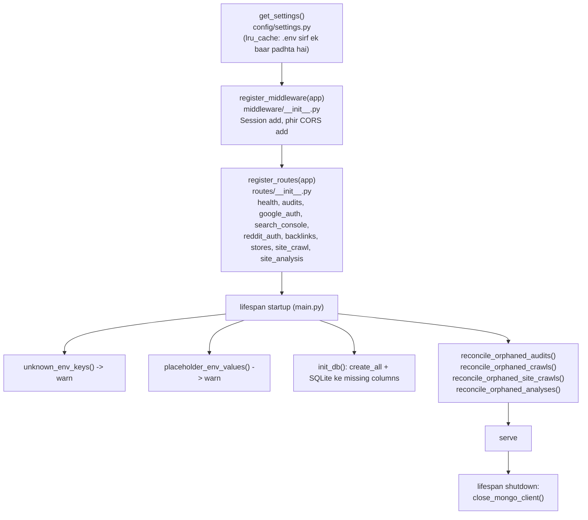
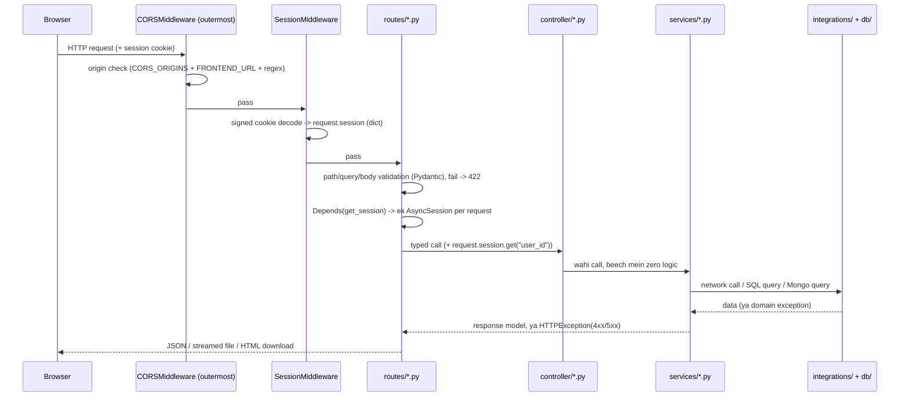
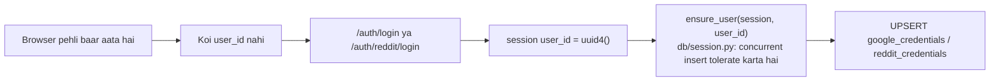
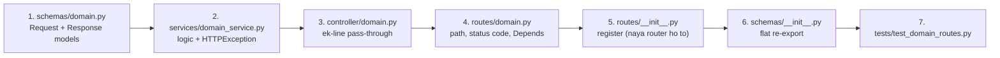

# 00 — Ek request ka poora safar

Ye page har doosre flow page ki base hai. Yahan wo sab hai jo **har** request ke saath
hota hai, chahe endpoint koi bhi ho.

---

## 1. Process boot hone par kya hota hai

`main.py` sirf bootstrap hai — ASGI target `main:app`. `server/` hi import root hai,
isliye har import top-level hai (`from routes...`, `from config import ...`).



### Startup ke do warnings — inhe ignore mat karna

`config/settings.py` mein `extra="ignore"` hai, matlab `.env` ki ek typo key chupchaap
ignore ho jaati hai aur feature off rehta hai bina kisi message ke. Isliye do checks
startup par chalte hain:

| Function | Kya pakadta hai | Example |
|---|---|---|
| `unknown_env_keys()` | Key ka **naam** galat hai (kisi setting se match nahi karta) | `GIMINI_API_KEY`, `REDDIT_CLIENT_SECERT` |
| `placeholder_env_values()` | Key sahi hai par **value** abhi bhi template hai | `GOOGLE_REDIRECT_URI=https://api.yourdomain.com/...` |

Markers: `REPLACE_ME`, `yourdomain.com`, `USER:PASSWORD`, `xxxxx.mongodb.net`, aur
`REDDIT_USER_AGENT` mein `CHANGE_ME` (jab Reddit configured ho). **Values kabhi log nahi
hoti — sirf key names.**

### Teen launch tareeke

```bash
python main.py                                   # kisi bhi cwd se - production launch
uvicorn --app-dir /path/to/server main:app --host 0.0.0.0 --port 8000
uvicorn main:app --reload                        # dev, sirf server/ se
```

`python main.py` settings se `HOST:PORT` bind karta hai aur app **object** directly
run karta hai (string `"main:app"` nahi) — taaki kisi reloader/worker subprocess mein
alag cwd ke saath import-by-name na ho.

> `--reload` har file save par worker process restart karta hai, aur **har in-process
> job mar jaata hai**. Dekho [08-background-jobs-flow.md](08-background-jobs-flow.md).

---

## 2. Request ka safar



### Middleware order load-bearing hai

`middleware/__init__.py` mein:

```python
app.add_middleware(SessionMiddleware, ...)   # pehle add
app.add_middleware(CORSMiddleware, ...)      # baad mein add
```

**Jo middleware LAST add hota hai wo FIRST chalta hai.** Isliye CORS outermost rehta
hai — uske headers browser tak tab bhi pahunchte hain jab response ek error ho. Order
badla to error responses par CORS header gayab ho jayenge aur browser mein wo
"network error" jaisa dikhega.

| Middleware | Settings |
|---|---|
| `SessionMiddleware` | cookie naam `session`, `same_site="lax"`, `https_only=False` (production HTTPS par `True` karein), `max_age` 30 din, `SESSION_SECRET` se signed |
| `CORSMiddleware` | `cors_origin_list` (= `CORS_ORIGINS` + `FRONTEND_URL`), `CORS_ORIGIN_REGEX` (localhost/LAN), `allow_credentials=True`, saare methods/headers |

> `SESSION_SECRET` blank hai to ek **ephemeral** secret generate hota hai aur warning
> log hoti hai — matlab har restart par Google/Reddit connections toot jaayenge.

### Routes ka registration order bhi load-bearing hai

`routes/__init__.py` ka order jaan-boojh kar preserve kiya gaya hai. Aur
`routes/stores.py` ke andar **literal paths pehle**:

```
/api/stores/crawl                ← literal, pehle
/api/stores/crawls               ← literal, pehle
/api/stores/crawl/{crawl_id}     ← literal prefix, pehle
/api/stores/{store_domain}/...   ← parameter, BAAD mein
```

Order ulta kiya to `/api/stores/crawls` ek store domain ban jaayega jiska naam
`"crawls"` hai. `routes/site_crawl.py` mein ye trap nahi hai (wahan koi literal segment
parameter se compete nahi karta) — aur uski docstring ye explicitly likhti hai.

---

## 3. Session aur identity

**Koi login screen nahi hai.** `SessionMiddleware` har browser ko ek signed cookie deta
hai. Jab user Google ya Reddit connect karta hai, credentials
`request.session["user_id"]` ke against store hote hain.



- Baaki sab kuch **anonymous** hai — audit, crawl, analysis bina connection ke chalte hain.
- `ensure_user()` deliberately `begin_nested()` savepoint + `IntegrityError` catch use
  karta hai: ek double-clicked Connect button do callbacks bhej deta hai, aur plain
  "SELECT then INSERT" primary-key race haar jaata hai.
- Tests mein (`TestClient`) koi `user_id` nahi hota, isliye credential-dependent seams
  (jaise `gsc_connected(user_id)`) monkeypatch kiye jaate hain.

---

## 4. DB session ka lifecycle

```python
# routes/*.py
session: AsyncSession = Depends(get_session)
```

`db/session.py::get_session` — **ek session per request**, generator ke through, request
khatam hone par automatically band.

> **Workers ise use nahi karte.** Ek background job ko sirf **row id** milti hai aur wo
> **chhote-chhote sessions** kholta hai — ek session kabhi bhi kisi network phase ke
> across hold nahi hota. Warna SQLite "database is locked" degi. Dekho
> [08-background-jobs-flow.md](08-background-jobs-flow.md).

`init_db()` do kaam karta hai:

1. `Base.metadata.create_all` — missing **tables** banata hai
2. `_add_missing_columns` — sirf SQLite par, missing **columns** ke liye
   `ALTER TABLE ... ADD COLUMN`, **sirf tab jab column nullable ya server-defaulted ho**

Koi Alembic nahi hai. Isliye: **existing table mein naya column hamesha nullable rakho**
aur use `row.x or 0` ki tarah padho.

Ek aur guard: agar SQLite ka parent directory exist nahi karta, to SQLAlchemy ka bare
"unable to open database file" ek clear `RuntimeError` mein badal diya jaata hai jo
path aur `DATABASE_URL` dono naam leta hai. Directory **deliberately auto-create nahi
hoti** — production par wo database ko galat volume mein daal deti.

---

## 5. Errors → HTTP

Koi custom exception handler registered nahi hai. Services **directly `HTTPException`
raise** karti hain, aur routes kabhi raw integration errors nahi dekhte.

| Condition | Status |
|---|---|
| Unknown id | 404 |
| Job abhi terminal nahi hua (export/report bahut jaldi maanga) | 409 |
| Pydantic validation fail (body, `Literal` query, regex path) | 422 |
| Feature configured hi nahi (key/URL/binary missing) | 503 |
| Upstream live fail hui (Gemini 5xx, Ollama down, CLI error, Reddit/Google) | 502 |
| User ke connection par precondition (GSC ke bina analysis) | 400 |
| robots.txt ne crawler ko disallow kiya | 403 |
| MongoDB read ke waqt down | 503 |

Domain exceptions `exceptions/` mein rehti hain aur flat re-export hoti hain:
`FetchError`, `RobotsDisallowed`, `CatalogUnavailable`, `GeminiError`, `OllamaError`,
`ClaudeCliError`, `RedditRateLimited`, `GuardrailError`, `DraftValidationError`, …

Poori table: [../Reference/error-codes.md](../Reference/error-codes.md).

---

## 6. Naya endpoint add karne ka checklist



Dhyan rakhne layak:

1. **Literal path hamesha parameter path se pehle** declare karo (stores wala trap).
2. Service mein hi `HTTPException` uthao — controller/route mein nahi.
3. Long work hai? Job row + background task, aur `202` return karo — sync mat rakho.
4. Download hai? `Content-Disposition` **aur** `Access-Control-Expose-Headers:
   Content-Disposition` dono set karo, warna frontend filename nahi padh paayega.
5. Naya `.env` key? `config/settings.py` ke `Settings` mein field add karo — warna
   `extra="ignore"` use chupchaap kha jaayega.
6. Mongo **write** fail hone par raise mat karo (log + 0 return); Mongo **read** fail
   ho to 503 "MongoDB unavailable: …" do.

---

## Aage

- Kisi specific endpoint ka flow → [Flows index](README.md)
- Contract/limits → [../Pipelines/endpoint-index.md](../Pipelines/endpoint-index.md)
- Kaun si file kya karti hai → [../Reference/file-map.md](../Reference/file-map.md)
