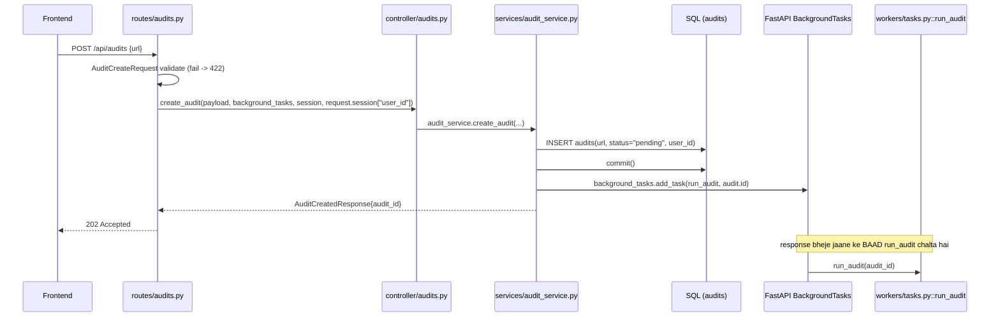
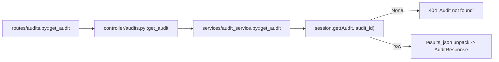
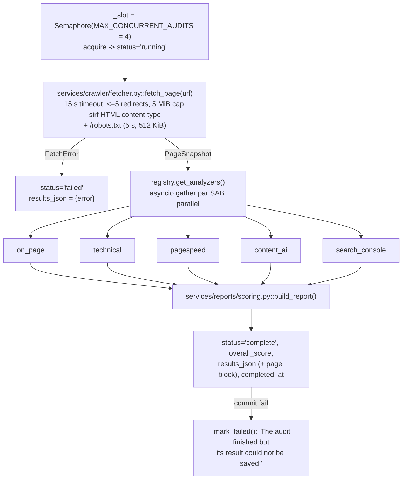
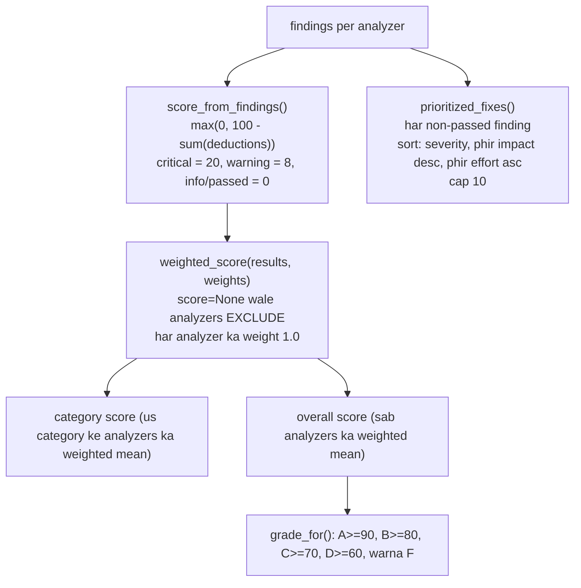

# 01 — Page audit flow (`/api/audits`)

**Ek line mein:** ek URL do, server use fetch karta hai, paanch analyzers parallel mein
chalate hain, aur ek scored report + ranked fixes deta hai.

Ye project ka sabse purana feature hai aur sabse simple job model use karta hai —
**Model B** (FastAPI `BackgroundTasks`): na heartbeat, na stop button.

---

## 1. Call chain — `POST /api/audits`



### File-by-file

| Step | File | Symbol | Kya karta hai |
|---|---|---|---|
| 1 | `routes/audits.py` | `create_audit` | Path, `202`, `AuditCreateRequest` validate, `BackgroundTasks` aur session inject |
| 2 | `controller/audits.py` | `create_audit` | Pass-through, zero logic |
| 3 | `services/audit_service.py` | `create_audit` | `Audit` row banata hai, commit, task register, `audit_id` return |
| 4 | `workers/tasks.py` | `run_audit` | Asli kaam — neeche §3 |

> `user_id` yahin record hota hai taaki `search_console` analyzer run ke dauran is page
> ka asli GSC performance attach kar sake.

---

## 2. Call chain — `GET /api/audits/{audit_id}`



**Important:** `overall_score` aur `status` ke alawa **sab kuch** `results_json` column
se padha jaata hai — `grade`, `categories`, `prioritized_fixes`, `page`, `error`. Column
abhi khaali hai (pending/running) to ye fields default/None aate hain, 404 nahi.

Frontend har 2 second par ye endpoint poll karta hai
(`frontend-design/src/state/auditStore.ts`).

---

## 3. Background job — `workers/tasks.py::run_audit`



### Analyzer discovery — koi wiring nahi

`services/analyzers/registry.py` **automatic module discovery** karta hai:
`services/analyzers/` ka koi bhi module (`base` aur `registry` chhod kar) first use par
import ho jaata hai, aur `@register_analyzer` se decorated class apne aap registry mein
aa jaati hai.

```python
@register_analyzer
class MyAnalyzer(BaseAnalyzer):
    name = "my_analyzer"
    category = "on_page"
    weight = 1.0
```

Bas file drop karo — koi list update nahi karni.

### Ek analyzer kabhi raise nahi karta

`services/analyzers/base.py::BaseAnalyzer.analyze` har exception ko pakad kar
`AnalyzerResult(score=None, error="Type: msg")` bana deta hai, `duration_ms` ke saath.
Matlab ek toota analyzer poore audit ko nahi girata — wo apni category mein ek error
line ban jaata hai.

---

## 4. Paanch analyzers — kaun kya dekhta hai

| Analyzer (category) | File | Kya check karta hai | Bahar ki call |
|---|---|---|---|
| `on_page` (`on_page`) | `services/analyzers/on_page.py` | title missing (critical) / 30–60 chars; meta description 70–160; bilkul ek H1; heading level skips; image alt coverage; >=1 internal link; canonical; og:title/description/image; >=300 words; `<html lang>` | — |
| `technical` (`technical`) | `services/analyzers/technical.py` | 2xx pass, >=400 critical; redirects 0/1/2+; HTTPS; response time <800 ms / <2500 ms; robots.txt 200; noindex (meta ya `X-Robots-Tag`) critical; viewport; charset; favicon | — |
| `pagespeed` (`performance`) | `services/analyzers/pagespeed.py` | performance >=90/>=50; LCP <=2.5 s good / >4 s poor; INP <=200 ms / >500 ms; CLS <=0.1 / >0.25; lab ke mukable **CrUX field** percentiles prefer | PageSpeed Insights v5, 60 s timeout, cache key `psi:{strategy}:{categories}:{url}` |
| `content_ai` (`content`) | `services/analyzers/content_ai.py` | main text (nav/footer/aside strip, <=8000 chars, >=25 words) → intent match, E-E-A-T, gaps (<=5), rewrite, summary | Anthropic `LLMService.complete_json`, max 1500 tokens, 408/409/429/5xx par 3 retries. Key na ho to **skip** |
| `search_console` (`search_performance`) | `services/analyzers/search_console.py` | best-matching property (sabse lamba URL-prefix, warna `sc-domain:`); 28-din window jo 2 din pehle khatam; page-wise aur page+query (25 rows); findings: no data, summary, top queries, low CTR (impr >=100, CTR <2%, pos <=20.5), striking distance (pos 10.5–20.5, impr >=50) | Search Console API; sites aur rows 1 h cached; rows Mongo `gsc_search_analytics` mein mirror |

> `SITE_CRAWL_ANALYZERS` setting audits ko **affect nahi karti**. Audit hamesha paanchon
> chalaata hai. Wo setting sirf site crawl (§[02](02-site-crawl-flow.md)) ke bulk-safe
> subset ko chunti hai.

---

## 5. Scoring — number kahan se aata hai

`services/reports/scoring.py`:



Do exceptions: `pagespeed` ka score Lighthouse ka performance score hai, aur
`content_ai` ka score model ka intent-match score hai — wo `score_from_findings` use
nahi karte.

---

## 6. Terminal states

| Status | Kab |
|---|---|
| `pending` | Row ban gayi, semaphore slot ka wait |
| `running` | Slot mil gaya, fetch + analyzers chal rahe hain |
| `complete` | Report ban gayi aur save ho gayi |
| `failed` | `FetchError`, internal error, ya result save nahi ho saka |

**Koi `partial`, koi `stopped` nahi** — audit ek short job hai.

**Server restart** par `main.py` ka lifespan `reconcile_orphaned_audits()` chalaata hai:
har `pending`/`running` row **failed** mark ho jaati hai with
*"The server restarted before this audit finished."* Model B jobs ka koi heartbeat nahi
hota, isliye "kya ye abhi bhi zinda hai" ka koi tareeka nahi — sabko close kar diya
jaata hai.

---

## 7. Error codes

| Status | Kab |
|---|---|
| 202 | Audit create ho gaya |
| 404 | Unknown `audit_id` |
| 422 | `url` 1–2048 chars nahi; scheme http/https nahi; host mein `.` nahi aur `localhost` bhi nahi |

URL normalisation `schemas/audit.py` mein: trim hota hai, scheme na ho to `https://`
prepend hota hai.

---

## 8. Chhedne se pehle

- **`MAX_CONCURRENT_AUDITS = 4`** — `workers/tasks.py`. Badhane se pehle yaad rakho ki
  har audit ek PSI call + ek Anthropic call karta hai.
- **Analyzer add karna aasaan hai** (registry auto-discovery), par naya analyzer
  **site crawl** mein automatically nahi aayega — uska bulk-safe set
  `services/site_crawl_analysis.py` mein hard-limited hai.
- **`results_json` hi source of truth hai** read path par. Agar aap `AuditResponse` mein
  naya field add kar rahe ho, use `build_report()` ke output mein bhi daalna hoga.
- Audit **stop nahi** ho sakta. Agar stop chahiye to Model A (detached task) mein
  migrate karna padega — [08](08-background-jobs-flow.md) dekho.

---

## Related

- Pipeline contract: [../Pipelines/audit-pipeline.md](../Pipelines/audit-pipeline.md)
- Frontend: [../../../frontend-design/docs/Workflow/01-page-audit.md](../../../frontend-design/docs/Workflow/01-page-audit.md)
