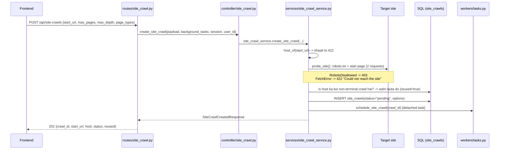
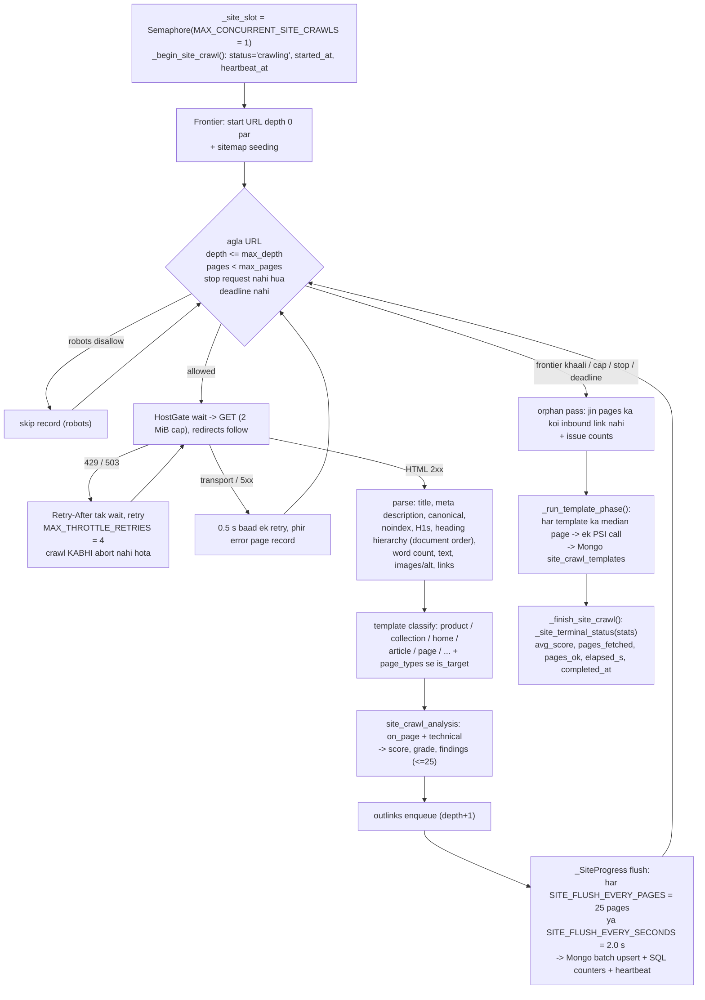
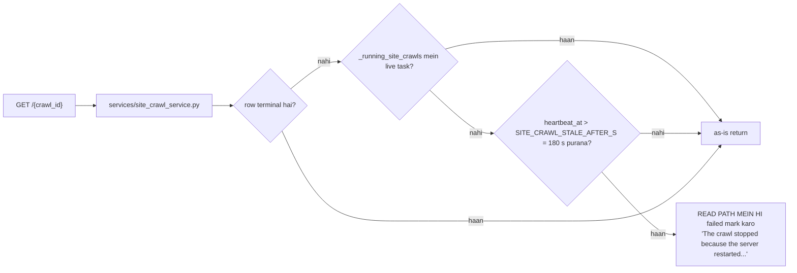
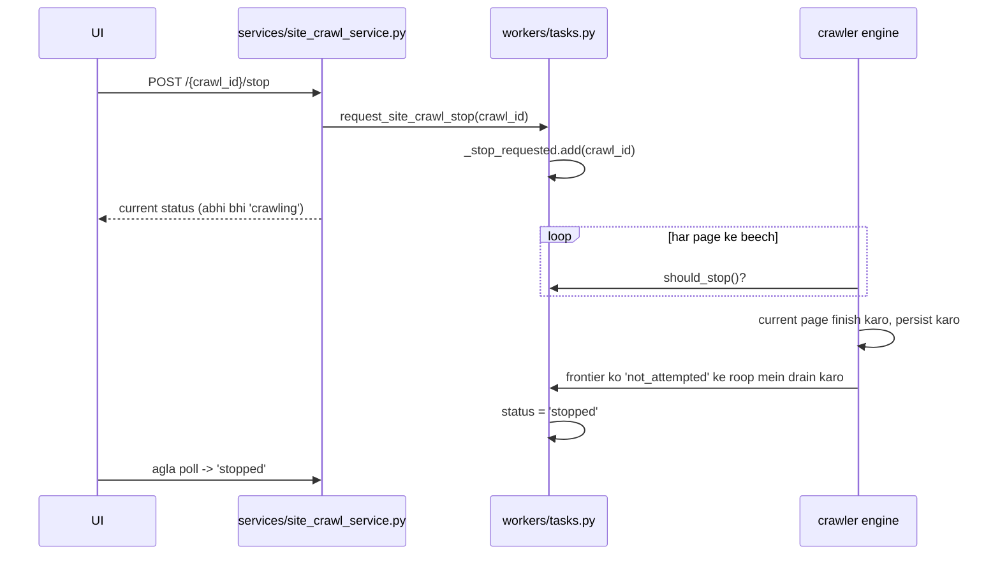

# 02 — Site crawl flow (`/api/site-crawls`)

**Ek line mein:** ek URL se poori site breadth-first crawl karta hai, har page MongoDB
mein likhta hai, pages ko score karta hai, har *template* ke liye ek Lighthouse run
measure karta hai.

Ye project ka **workhorse** hai — full analysis (§[03](03-site-analysis-flow.md)) aur
reports/exports (§[07](07-report-and-export-flow.md)) dono isi ke upar bane hain.

Job model: **Model A** (detached asyncio task) — client disconnect hone par bhi zinda
rehta hai, heartbeat karta hai, aur cooperative stop support karta hai.

---

## 1. Call chain — `POST /api/site-crawls`

### Request fields (`schemas/site_crawl.py::SiteCrawlCreateRequest`)

| Field | Bounds | Matlab |
|---|---|---|
| `start_url` | 1–2048 chars | Site ka koi bhi URL; host isse derive hota hai. Scheme na ho to https assume |
| `max_pages` | 0 – `MAX_REQUESTABLE_PAGES = 5000` | **0 = koi page cap nahi** (UI ka "No limit") |
| `max_depth` | 0 – `MAX_REQUESTABLE_DEPTH = 10` | Start URL se link-depth |
| `page_types` | `["product"]` / `["collection"]` / dono / khaali | Sirf yahi **targets** hain; baaki pages sirf inhe reach karne ke liye fetch hote hain |
| `max_navigation_pages` | 0–5000 | Non-target pages ka budget |

> Schema jaan-boojh kar **clamp nahi** karta — `max_pages=1000000` bheja to 422 milega,
> chupchaap 5000 nahi. Ek saaf 422 ek silent clamp se behtar hai.

### `reused=true` kab aata hai

Us host ka ek crawl pehle se non-terminal (`pending`/`crawling`) hai → naya row nahi
banta, purani job wapas de di jaati hai. Frontend uske `crawl_id` ko poll karna shuru
kar deta hai.

---

## 2. Background job — `workers/tasks.py::run_site_crawl`

### Engine kahan rehta hai

| Concern | File |
|---|---|
| Site-wide engine, pre-flight probe, page facts | `services/crawler/site_crawl.py` |
| URL normalise, link extract, catalog classify | `services/crawler/urls.py` |
| `CrawledPage`, `CrawlLimits`, `CrawlStats`, `SiteCrawlResult` | `services/crawler/models.py` |
| Pooled client, capped reads, SSRF guard, robots fetch | `services/crawler/http_client.py` |
| Single-page fetch (audit bhi use karta hai) | `services/crawler/fetcher.py` |
| robots.txt parse + Crawl-delay | `services/crawler/robots.py` |
| Sitemap discovery | `services/crawler/sitemap.py` |
| Template detection | `services/crawler/templates.py` |
| Per-host pacing (`HostGate`) | `services/crawler/throttle.py` |
| HTML parse (selectolax) | `services/crawler/parser.py` |

Poora deep-dive: [../crawler.md](../crawler.md).

### Teen behaviours jo surprise karte hain

1. **Heading hierarchy document order mein padhi jaati hai** (`node.traverse()`), kyunki
   selectolax ka `css("h1,h2,...")` matches ko **tag ke hisaab se grouped** return karta
   hai. `heading_skips` level jumps (H2 → H4) count karta hai.

2. **Rate limiting kabhi fatal nahi.** Throttled page `Retry-After` honour karte hue
   retry hota hai (gate ×4 back off, 30 s tak; success par ×0.8 recover). Jo page phir
   bhi throttled rahe wo *skipped* record hota hai aur crawl aage badhta hai.

3. **Target vs navigation pages.** `page_types` set hai to non-target pages **phir bhi
   fetch hote hain** (links unhi mein hote hain) par `is_target=false` flag hote hain.
   Listings aur exports unhe chhupate hain jab tak `include_navigation=true` na ho.
   Robots-blocked pages bhi classify hote hain, taaki products-only report kabhi koi
   blocked URL leak na kare.

4. **Lighthouse per TEMPLATE hai, per page nahi.** Ek store mein sainkdon product pages
   hote hain aur ek product template; us template ke **median page** (word count ke
   hisaab se) par ek PSI run un sabko represent karta hai. Ek PSI call 10–30 s leti hai.

---

## 3. Read endpoints

| Endpoint | Service symbol | Kya deta hai |
|---|---|---|
| `GET /{crawl_id}` | `get_site_crawl` | Status, progress, `pages_fetched/ok`, `avg_score`, grade, headline issue counts, options, error. **Read par stale row reap karta hai** |
| `GET /{crawl_id}/pages` | `get_site_crawl_pages` | Paginated page list. `limit` 1–200 (50), `offset`, `sort` ∈ depth/url/status/words/links/score, `issue` filter, `include_navigation` |
| `GET /{crawl_id}/page?url=` | `get_site_crawl_page` | Ek page + uske outlinks + us par link karne wale pages (**inlinks**) |
| `GET /{crawl_id}/issues` | `get_site_crawl_issues` | Har issue ke counts + orphan list (`MAX_ORPHANS_LISTED = 200`) |
| `GET /{crawl_id}/templates` | `get_site_crawl_templates` | Har template ka ek record + Lighthouse + Core Web Vitals |
| `POST /{crawl_id}/stop` | `stop_site_crawl` | Cooperative stop (neeche §4) |
| `GET /api/site-crawls?host=&limit=` | `list_site_crawls` | Recent crawls, newest first |

> **Mid-crawl counts kam dikhte hain.** Pages batches mein likhe jaate hain, aur `orphan`
> sirf tab exist karta hai jab poora graph pata ho. Unhe final sirf terminal status ke
> baad maano.

---

## 4. Cooperative stop

`POST /{crawl_id}/stop` **task cancel nahi karta** — cancellation data mid-write drop kar
deti.

Frontend poller stop ke baad bhi chalta rehta hai — `stopped` status agle poll par
dikhta hai, local pe fake nahi kiya jaata.

---

## 5. Terminal states

| Status | Kab (`_site_terminal_status`) |
|---|---|
| `complete` | Normal khatma, koi abort/cap/deadline nahi |
| `partial` | `aborted_reason`, page budget hit, deadline hit, depth overflow, ya transport errors |
| `stopped` | User ne stop kiya — **jo pages mile wo rakhe jaate hain** |
| `failed` | `pages_fetched == 0`; probe error/timeout; robots disallow; ya restart ke baad reap |

Why-it-stopped flags row par bhi hain: `hit_page_budget`, `deadline_hit`,
`aborted_reason` — frontend `CrawlOverview` inhi se "why it stopped" line banata hai.

---

## 6. Limits aur budgets

| Constant / setting | Value | Kahan |
|---|---|---|
| `MAX_CONCURRENT_SITE_CRAWLS` | 1 | `workers/tasks.py` |
| `SITE_CRAWL_STALE_AFTER_S` | 180 s | `workers/tasks.py` |
| `SITE_PROBE_TIMEOUT_SECONDS` | 30 s | `workers/tasks.py` |
| `SITE_FLUSH_EVERY_PAGES` / `_SECONDS` | 25 / 2.0 s | `workers/tasks.py` |
| `TIMEOUT_SECONDS` / `MAX_REDIRECTS` | 15.0 s / 5 | `services/crawler/fetcher.py` |
| `MAX_THROTTLE_RETRIES` | 4 | `services/crawler/site_crawl.py` |
| `MAX_SKIP_RECORDS` | 200 | `services/crawler/site_crawl.py` |
| `MAX_ORPHANS_LISTED` | 200 | `services/site_crawl_service.py` |
| `TEMPLATE_SAMPLE_CAP` / `MAX_TEMPLATES_TESTED` / `TEMPLATE_CONCURRENCY` / `TEMPLATE_PHASE_TIMEOUT_S` | 600 / 8 / 2 / 480 s | `workers/tasks.py` |
| `SITE_CRAWL_CONCURRENCY` | 6 | setting |
| `SITE_CRAWL_DEADLINE_S` | 30 min | setting |
| `SITE_CRAWL_MIN_INTERVAL_S` | 0.1 s | setting (robots Crawl-delay ise **badha** sakta hai, ghata nahi) |
| `SITE_CRAWL_INCLUDE_SUBDOMAINS` | false | setting |
| `SITE_CRAWL_ANALYZERS` | `on_page,technical` | setting (bulk-safe set) |
| `SITE_CRAWL_TEXT_CHARS` | 8000 | setting |

---

## 7. Error codes

| Status | Kab |
|---|---|
| 403 | Site ka robots.txt crawler ko disallow karta hai (`RobotsDisallowed`) |
| 404 | Unknown `crawl_id`; ya `/page?url=` mein aisa URL jo is crawl mein nahi |
| 409 | Crawl terminal hone se pehle `export`/`report` maanga |
| 422 | `start_url` mein host nahi; body validation; ya probe site tak pahunch nahi paaya |
| 503 | Kisi bhi page-data read par MongoDB unreachable |

---

## 8. Chhedne se pehle

- **`SITE_CRAWL_ANALYZERS` mein sirf bulk-safe analyzers daalo.** `services/site_crawl_analysis.py`
  us set ke bahar ka naam **refuse** karta hai — kyunki `pagespeed`, `content_ai` aur
  `search_console` har ek apni outbound call karte hain, to 500 pages par wo 500
  Lighthouse runs ya 500 LLM completions ban jaate.
- **Concurrency 1 hai.** Do crawls ek saath chalane ke liye `MAX_CONCURRENT_SITE_CRAWLS`
  badhana padega — par memory aur target site ki politeness dono soch kar.
- Mongo down hai to crawl **chal jaayega** par `persistence_ok=false` set hoga aur
  `error_message` batayega. Pages save nahi honge.
- Stop ko cooperative hi rakho — `task.cancel()` mid-write batch kho dega.

---

## Related

- Pipeline contract: [../Pipelines/site-crawl-pipeline.md](../Pipelines/site-crawl-pipeline.md)
- Engine deep-dive: [../crawler.md](../crawler.md)
- Frontend: [../../../frontend-design/docs/Workflow/03-site-crawl.md](../../../frontend-design/docs/Workflow/03-site-crawl.md)
