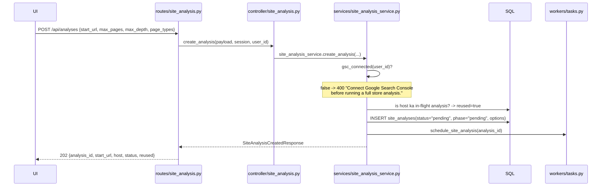
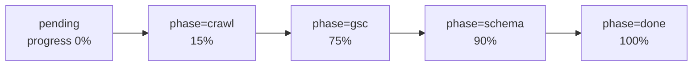
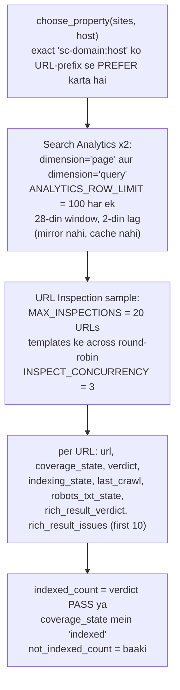
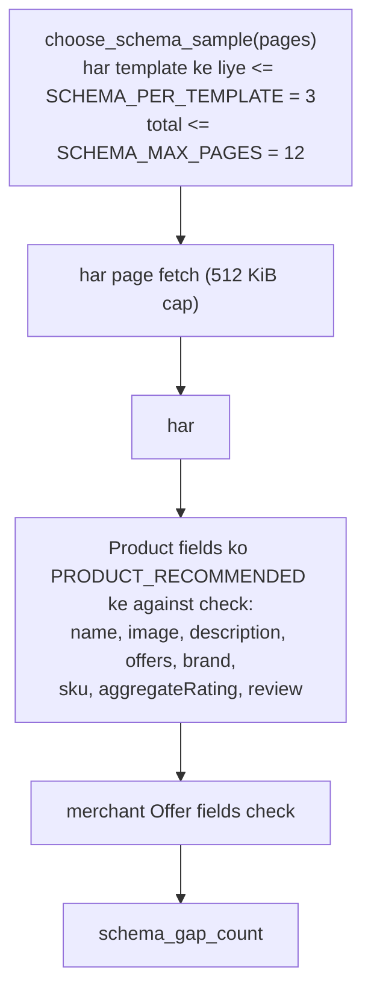
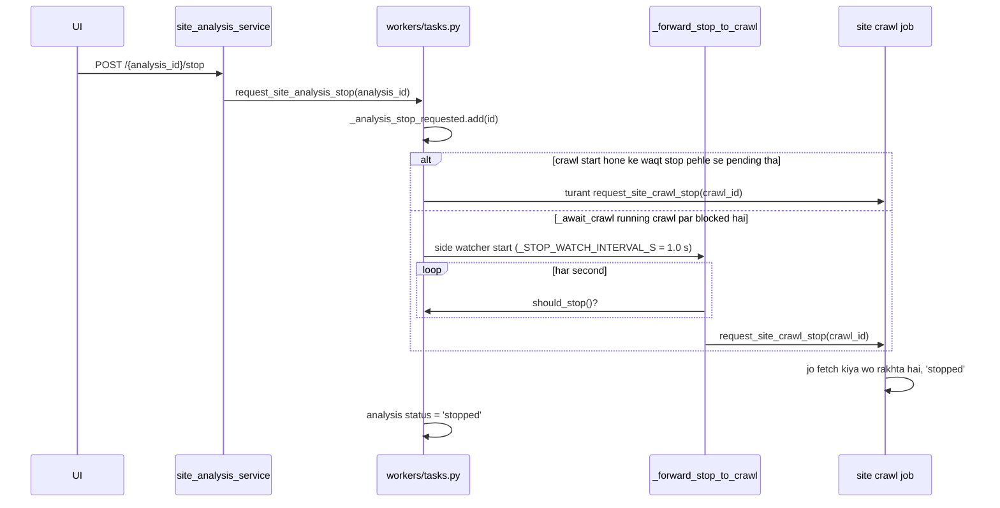

# 03 — Full store analysis flow (`/api/analyses`)

**Ek line mein:** ek button jo ek crawl chalaata hai, phir uske upar **Search Console**
aur ek **structured data check** layer karta hai, taaki report indexation aur rich
results ke baare mein baat kar sake.

Ye crawl job ko **bina badle reuse** karta hai aur apni row par sirf roll-up store karta
hai. Job model: **Model A** (detached task), `MAX_CONCURRENT_ANALYSES = 1`.

---

## 1. Call chain — `POST /api/analyses`

### GSC gate — ye deliberate hai

`gsc_connected(user_id)` true hona **zaroori** hai. Warna **400**.

Wajah: ye poori pipeline hi GSC ko fold-in karne ke liye exist karti hai. Bina uske
report ka ek-tihai hissa chupchaap missing reh jaata, aur user ko kabhi pata nahi
chalta ki kyun. Isliye gate upfront hai.

Frontend ise pehle hi handle karta hai — `AnalysisPage` `getGscStatus()` call karke
submit button disable kar deta hai aur "Connect Google Search Console first" card dikhata
hai.

### `max_pages = 0` ka matlab

`SiteAnalysisCreateRequest` mein `max_pages` 0–5000 accept karta hai, aur **0 = koi page
cap nahi** (form ka "All pages" toggle). Depth limit aur crawl ki 30-minute deadline
**phir bhi** apply hoti hain, isliye ek bahut bada store hamesha ke liye chalne ke
bajaye `deadline_hit` ke saath `partial` par khatam hota hai.

---

## 2. Pipeline — `workers/tasks.py::run_site_analysis`

Percentages `_PHASE_PCT` se aate hain; frontend `PipelineProgress` stepper inhi phases
ko naam se dikhata hai.

### Phase-by-phase

| Phase | Function | Kya hota hai | Best-effort? |
|---|---|---|---|
| **crawl** | `_spawn_crawl` + `_await_crawl` | `create_site_crawl` ko analysis ke options ke saath call karta hai, `crawl_id` store karta hai; phir har 3 s poll karta hai (analysis row ko heartbeat karte hue) zyada se zyada `ANALYSIS_CRAWL_WAIT_S = 35 min` tak. `pages_fetched`, `avg_score`, `templates_measured` copy karta hai | **Nahi** — crawl nahi to analysis nahi (`failed`) |
| **gsc** | `services/site_analysis_gsc.py::collect_gsc` | Neeche §3 | **Haan** — koi bhi failure `gsc_error` mein, `gsc_connected=false` |
| **schema** | `services/site_analysis_schema.py::sample_schema` | Neeche §4 | **Haan** — note hota hai, kabhi fatal nahi |
| **done** | — | `result_json = {"gsc": ..., "schema": ...}`, `notes[]`, `status`, `completed_at` | |

---

## 3. GSC phase — `services/site_analysis_gsc.py`

Sirf worker ke andar chalta hai, kabhi request path mein nahi.

**URL Inspection kyun?** Search Console API bulk mein unindexed pages ya schema errors
list **nahi kar sakti**. Isliye analysis inspection results ko *sample* karta hai —
templates ke across round-robin, taaki ek hi template ke 20 pages na nikal jaayein. API
roughly 2,000/day allow karti hai, to 20 ek safe sample hai.

Har failure ek **note** hai, kabhi crash nahi.

---

## 4. Schema phase — `services/site_analysis_schema.py`

Apni schema parsing isliye hai kyunki Google ki taraf se koi bulk "is page ka schema
kitna complete hai" API nahi hai.

---

## 5. Read, stop, outputs

| Endpoint | Service symbol | Behaviour |
|---|---|---|
| `GET /{analysis_id}` | `get_analysis` | `status`, `phase`, `progress_pct`, `crawl_id`, GSC fields, counts, `result`, `notes`, timestamps. **Stale rows reap karta hai** (`ANALYSIS_STALE_AFTER_S = 300`) |
| `GET /api/analyses?host=&limit=` | `list_analyses` | Newest first |
| `POST /{analysis_id}/stop` | `stop_analysis` | Neeche §6 |
| `GET /{analysis_id}/export.{fmt}` | `get_analysis_export` | Terminal na ho to 409; crawl produce na hua to 409; crawl row gayab to 404; warna **crawl export ko delegate** karta hai |
| `GET /{analysis_id}/report.html?engine=` | `generate_analysis_report` | Wahi gates; phir report pipeline (§[07](07-report-and-export-flow.md)) |

---

## 6. Stop cascade — analysis se crawl tak

Ye flow ka sabse non-obvious hissa hai: analysis apne **child crawl** tak stop forward
karta hai.

Side watcher isliye chahiye kyunki `_await_crawl` crawl ka wait kar raha hota hai —
agar wo khud stop flag check karta to crawl khatam hone tak kuch nahi hota.

---

## 7. Terminal states

| Status | Kab |
|---|---|
| `complete` | Normal khatma. **Note:** jo crawl pages *ke saath* `failed` par khatam hua, wo bhi `complete` report hota hai |
| `partial` | Crawl `partial` ya `stopped` par khatam hua, ya koi phase skip hua |
| `stopped` | Stop request hua |
| `failed` | Crawl start nahi ho saka / koi page fetch nahi hua; ya "server restarted" reap |

---

## 8. Limits

| Constant | Value | Kahan |
|---|---|---|
| `MAX_CONCURRENT_ANALYSES` | 1 | `workers/tasks.py` |
| `ANALYSIS_STALE_AFTER_S` | 300 s | `workers/tasks.py` |
| `ANALYSIS_CRAWL_WAIT_S` | 35 min (3 s polling) | `workers/tasks.py` |
| `_STOP_WATCH_INTERVAL_S` | 1.0 s | `workers/tasks.py` |
| `MAX_INSPECTIONS` / `INSPECT_CONCURRENCY` / `ANALYTICS_ROW_LIMIT` | 20 / 3 / 100 | `services/site_analysis_gsc.py` |
| `SCHEMA_PER_TEMPLATE` / `SCHEMA_MAX_PAGES` | 3 / 12 (512 KiB per fetch) | `services/site_analysis_schema.py` |

---

## 9. Jaanne layak gotcha — analysis report ka `derived` block

`services/site_analysis_report.py::build_analysis_payload` ek `export` argument accept
karta hai (crawl ka **full page export**) taaki `derived` cross-checks compute kar sake:
duplicate titles, identical/empty/thin pages, canonical groups, per-template bands — aur
model ko bataya jaata hai ki ye counts authoritative hain.

**Service abhi wo export pass nahi karti.** Isliye `_find_export` payload ki pehli aisi
list par fall back karta hai jo pages jaisi dikhti hai: `example_pages`, zyada se zyada
8 rows. Jab tak service real export supply nahi karti
(`iter_pages` → `{crawl, issue_counts, templates, pages}`), `derived` sirf un examples ko
describe karta hai, **poore crawl ko nahi** — aur jab koi bhi na ho to `{"available": false}`.

> Ye ek known gap hai, bug nahi. Fix karna ho to `site_analysis_service` se
> `site_crawl_export.iter_pages(...)` ka output `build_analysis_payload(export=...)` mein
> pass karo.

---

## 10. Chhedne se pehle

- **GSC gate hatana mat** jab tak report ka GSC section optional na bana do — warna user
  ko ek adhoori report milegi bina kisi explanation ke.
- GSC aur schema dono **best-effort** hain. Unmein exception raise karoge to poori
  analysis fail ho jaayegi — unhe `notes` mein daalo.
- Analysis apna crawl **spawn** karta hai, isliye `MAX_CONCURRENT_SITE_CRAWLS = 1` ke
  saath ek analysis chalte waqt koi standalone crawl start nahi ho sakta.

---

## Related

- Pipeline contract: [../Pipelines/site-analysis-pipeline.md](../Pipelines/site-analysis-pipeline.md)
- Crawl flow: [02-site-crawl-flow.md](02-site-crawl-flow.md)
- Frontend: [../../../frontend-design/docs/Workflow/02-full-analysis.md](../../../frontend-design/docs/Workflow/02-full-analysis.md)
