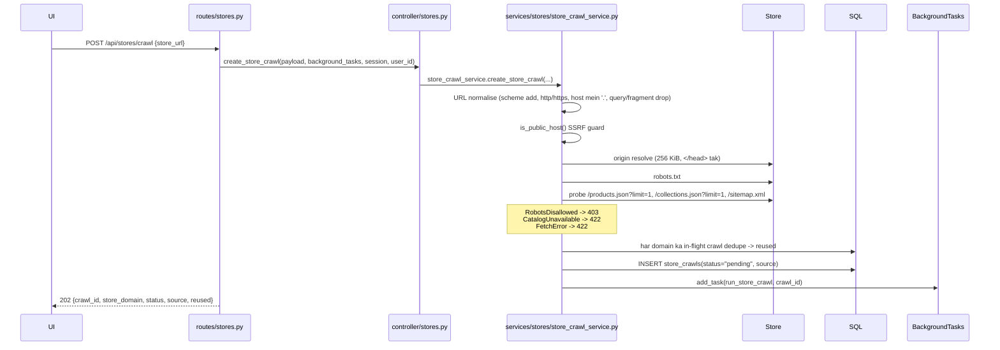
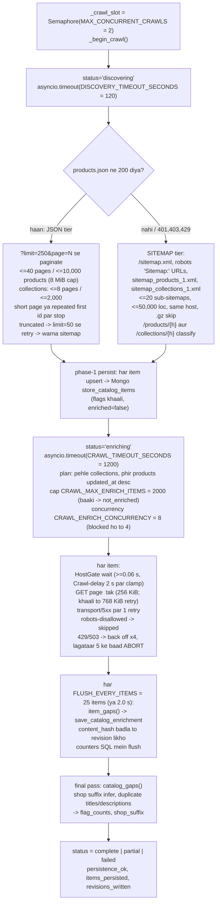

# 04 — Store catalog flow (`/api/stores`)

**Ek line mein:** ek Shopify-style store ka poora catalog (products + collections) uske
JSON endpoints ya sitemaps se discover karta hai, har item ko uske page ke `<head>` se
enrich karta hai, aur har item ke SEO gaps flag karta hai.

Job model: **Model B** (`BackgroundTasks`), `MAX_CONCURRENT_CRAWLS = 2` — na heartbeat,
na stop button.

> Ye site crawl (§[02](02-site-crawl-flow.md)) se **alag** cheez hai. Site crawl poore
> page fetch karta hai aur apna frontier khud discover karta hai; ye catalog crawl
> pehle se pata item list ke liye sirf `<head>` padhta hai.

---

## 1. Call chain — `POST /api/stores/crawl`



### Routing trap — padh lo

`routes/stores.py` ki docstring ise explicitly likhti hai:

```
/api/stores/crawl                 ← literal, PEHLE
/api/stores/crawls                ← literal, PEHLE
/api/stores/crawl/{crawl_id}      ← literal prefix, PEHLE
/api/stores/{store_domain}/flags            ← parameter
/api/stores/{store_domain}/products
/api/stores/{store_domain}/collections
/api/stores/{store_domain}/items/{kind}/{handle}
```

Order ulta kiya to `/api/stores/crawls` ek store domain ban jaayega jiska naam
`"crawls"` hai, aur crawl list endpoint silently 404/empty dene lagega.

---

## 2. Background job — `workers/tasks.py::run_store_crawl`

Do phases, do alag timeouts.



### Service files

| Concern | File |
|---|---|
| Create/read endpoints, HTTPException mapping | `services/stores/store_crawl_service.py` |
| JSON + sitemap discovery tiers | `services/stores/discovery.py` |
| `<head>` fetch + parse per item | `services/stores/enrichment.py` |
| SEO gap flags (`item_gaps`, `catalog_gaps`) | `services/stores/seo_gaps.py` |
| `CatalogItem` aur related models | `services/stores/models.py` |
| `(store_domain, kind, handle)` identity | `services/stores/store_key.py` |
| Mongo reads/writes | `db/store_catalog.py` |
| Progress tracking + flush | `workers/tasks.py::_ProgressTracker` |

### `source` field kya batata hai

| Value | Matlab |
|---|---|
| `products_json` | Products (aur collections, agar koi hain) JSON se aaye |
| `sitemap` | Dono mein se koi JSON se nahi aaya |
| `mixed` | Ek JSON se, doosra sitemap se |

---

## 3. Terminal status rules

| Status | Kab |
|---|---|
| `failed` | Kuch bhi discover ya enrich nahi hua; ya `RobotsDisallowed` / `CatalogUnavailable` / `FetchError`; ya ek phase timeout jisme kuch bhi enrich nahi hua |
| `partial` | Koi bhi failure, ek abort (5 consecutive 429/503), enrichment cap hit, ya timeout jisme kuch enrich hua |
| `complete` | Har planned item attempt hua, koi failure nahi, koi abort nahi |

`error_message` exactly batata hai kya hua:

```
"Enrichment stopped early: 5 consecutive 429s."
"N item(s) were not enriched (CRAWL_MAX_ENRICH_ITEMS=2000)."
"The crawl exceeded its 1200s budget and was stopped."
"...could not be saved: MongoDB is unavailable."
```

---

## 4. Read endpoints

| Endpoint | Returns | Notes |
|---|---|---|
| `GET /api/stores/crawls?store_domain=&limit=` | `StoreCrawlListResponse` | limit 1–200 (25), newest first |
| `GET /api/stores/crawl/{crawl_id}` | `StoreCrawlStatusResponse` | status, source, totals, `products_enriched`, `collections_enriched`, `enrich_failures`, `enrich_skipped`, `progress_pct`, `items_persisted`, `revisions_written`, `persistence_ok`, `shop_suffix`, `flag_counts`, `error` |
| `GET /{store_domain}/flags?kind=` | `StoreFlagCountsResponse` | Har flag ke kitne items |
| `GET /{store_domain}/products` · `/collections` | `StoreCatalogResponse` | `limit` 1–200 (50), `offset`, `sort` ∈ `gaps\|name\|handle` (default `gaps`), `only_gaps`, `flag` |
| `GET /{store_domain}/items/{kind}/{handle}` | `StoreCatalogItemDetailResponse` | Item + full description + `revisions[<=20]` |

`store_domain` **har read par normalise** hota hai: lower-case host, shuru ka `www.`
hata diya jaata hai.

`progress_pct` ka formula:

```
0   jab pending
5   jab discovering
5 + 95 * (enriched + failures) / total,  99 par capped
100 jab terminal
```

> `only_gaps` **mid-crawl under-report** karta hai: phase-1 docs par koi flag nahi hota
> jab tak enrichment un tak na pahunche. Terminal status ka wait karo.

---

## 5. SEO gap flags (`services/stores/seo_gaps.py`)

| Group | Flags |
|---|---|
| Meta title | `meta_title_missing`, `meta_title_short` (<30), `meta_title_long` (>60), `meta_title_is_default` |
| Meta description | `meta_description_missing`, `_short` (<70), `_long` (>160), `_is_default` |
| Content | `description_missing`, `image_missing`, `image_alt_missing`, `collection_empty` |
| Cross-item | `duplicate_meta_title`, `duplicate_meta_description`, `canonical_mismatch` |
| Not enriched (**exactly ek**) | `not_enriched` (cap-skipped), `page_unreachable` (fetch error / attempt nahi hua), `skipped_by_robots` |

**`is_default` ka matlab:** title mein se inferred shop suffix hataane par jo bacha wo
item name ke barabar hai (description ke liye: pehle 120 chars description ke barabar).

**Shop suffix** wo trailing `" | X"` / `" – X"` segment hai jo **>=60% enriched titles**
mein shared ho.

---

## 6. Storage

| Store | Collection / table | Identity | Kya rakhta hai |
|---|---|---|---|
| SQL | `store_crawls` | `id` | Har crawl ka ek row: status, source, totals, counters, `flag_counts` JSON, `shop_suffix`, `persistence_ok`, timestamps. **Koi heartbeat nahi** |
| Mongo | `store_catalog_items` | `(store_domain, kind, handle)` unique | Catalog fields + 200-char `description_excerpt`, `seo_flags[]`, `seo_gap_count`, `content_hash`, `first_seen_at`, `last_seen_at`, `enriched_at`, `last_crawl_id`, `source` |
| Mongo | `store_catalog_revisions` | `(store_domain, kind, handle, content_hash)` unique | Har content change par SEO-relevant fields ka snapshot — re-crawl se banne wali history |

`content_hash` = SEO-relevant fields ka SHA-256, **sirf enrichment ke baad set hota hai**.

---

## 7. Error codes

| Status | Kab |
|---|---|
| 202 | Crawl create ho gaya |
| 403 | robots.txt blanket-disallow |
| 404 | Unknown item |
| 422 | Host nahi; `CatalogUnavailable` ("No product or collection catalog found … tried /products.json, /collections.json, /sitemap.xml"); `FetchError` (unreachable, non-public host) |
| 503 | Catalog read ke waqt MongoDB down |

Kabhi crawl na hua store ek **empty list** return karta hai, 404 nahi.

---

## 8. Chhedne se pehle

- **Literal-before-parameter route order** mat todna.
- `CRAWL_MAX_ENRICH_ITEMS = 2000` deliberately hai: discovery uncapped hai, par
  enrichment (ek `<head>` fetch per item, ~0.2 s each) capped hai — taaki ek
  10,000-product store aadha ghanta crawl slot hold karne ke bajaye `partial` par
  khatam ho.
- **User-Agent spoof mat karo.** `CRAWLER_USER_AGENT` ek honest bot identity hai with
  contact URL. Browser UA spoof karna kai stores ki ToS breach hai.
- `CRAWL_HTTP2` opt-in hai: measured 23-item crawl par koi fark nahi pada (6.88 s vs
  6.95 s), aur `pip install "httpx[http2]"` chahiye. `h2` na ho to chupchaap HTTP/1.1.
- Ye job **stop nahi** ho sakta. Restart par `reconcile_orphaned_crawls()` har
  non-terminal row ko failed mark kar deta hai.

---

## Related

- Pipeline contract: [../Pipelines/store-catalog-pipeline.md](../Pipelines/store-catalog-pipeline.md)
- Teen crawl shapes ka farq: [../crawler.md](../crawler.md)
