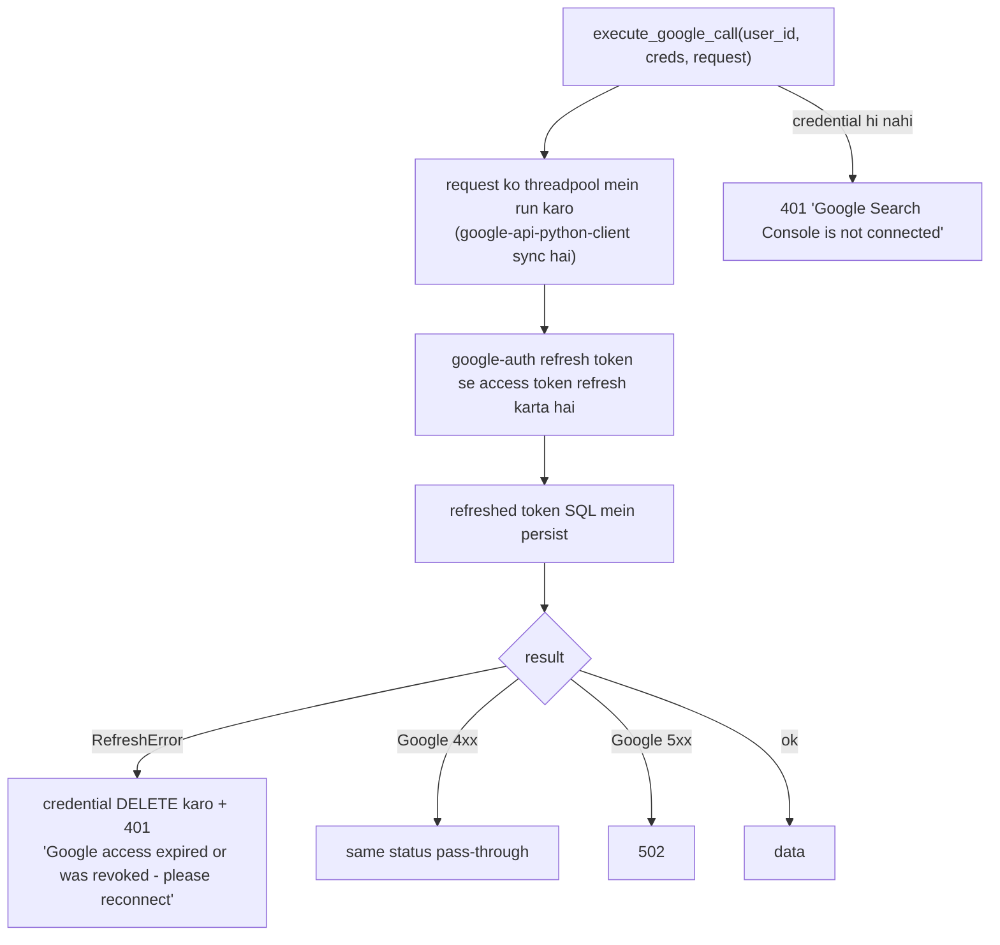
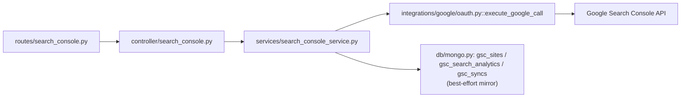
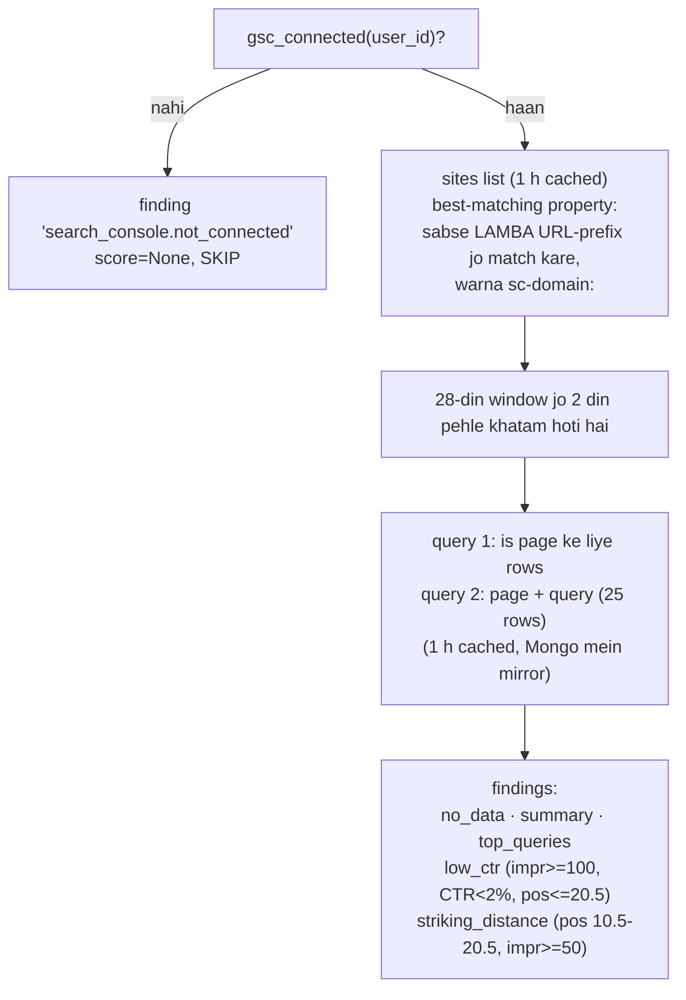

# 05 — Google Search Console flow (`/auth/*`, `/api/sites`, `/api/search-analytics`, `/api/gsc/*`)

**Ek line mein:** user ki Search Console properties tak read-only access — har browser
session mein ek baar Google OAuth se connect hota hai aur `google_credentials` table
mein store hota hai.

**Teen consumers** ise share karte hain:

1. Yahan ke endpoints (Search Console tab)
2. Audit ka `search_console` analyzer (§[01](01-audit-flow.md))
3. Full analysis ka GSC phase (§[03](03-site-analysis-flow.md))

---

## 1. Connect karna — OAuth flow

```mermaid
sequenceDiagram
  participant B as Browser
  participant RT as routes/google_auth.py
  participant SV as services/google_auth_service.py
  participant G as Google
  participant SQL

  B->>RT: GET /auth/login
  RT->>SV: login(request.session)
  SV->>SV: session["user_id"] = uuid4() agar missing
  SV->>SV: require_google_config() -> 503 agar client id/secret blank
  SV->>SV: Flow (PKCE), scopes = webmasters.readonly<br/>session["oauth_state"], session["pkce_code_verifier"]
  SV-->>B: 307 -> Google consent (access_type=offline, prompt=consent)
  B->>G: consent
  G-->>B: 302 /auth/callback?state=...&code=...
  B->>RT: GET /auth/callback
  RT->>SV: callback(session, query_params)
  SV->>SV: state == session["oauth_state"]? -> warna 400 "possible CSRF"
  SV->>G: POST oauth2.googleapis.com/token (code + verifier)
  G-->>SV: access + refresh token (fail -> 400 with hint)
  SV->>SQL: ensure_user(); UPSERT google_credentials<br/>(user_id, refresh_token, access_token, token_expiry, scopes)
  SV-->>B: 307 -> FRONTEND_URL/?connected=1<br/>(ya ?connected=0&reason=...)
```

| Endpoint | Behaviour |
|---|---|
| `GET /auth/login` | Google consent par redirect. `GOOGLE_CLIENT_ID`/`SECRET` blank → **503** |
| `GET /auth/callback` | State validate → code exchange → tokens store → frontend par redirect |
| `GET /auth/status` | `{connected}` = is session ka ek `google_credentials` row exist karta hai. **Koi Google call nahi** |
| `POST /auth/disconnect` | Row delete. **Google ko koi revoke call nahi**; session apna `user_id` rakhta hai |

---

## 2. Har Google call ek hi gate se guzarti hai

`integrations/google/oauth.py::execute_google_call(user_id, creds, request)` — **saari**
Google calls isi se jaati hain.



> `RefreshError` par credential **delete** karna jaan-boojh kar hai: ek revoke kiya hua
> refresh token kabhi wapas kaam nahi karega, aur use rakhne ka matlab hai user ko
> hamesha "expired" error dikhte rehna bina reconnect prompt ke.

---

## 3. Live endpoints (Google ko call karte hain)

| Endpoint | Request | Kya hota hai | Response |
|---|---|---|---|
| `GET /api/sites` | — | `sites.list`; `siteUrl` khaali ya `permissionLevel == siteUnverifiedUser` wali entries **drop** hoti hain; list Mongo `gsc_sites` mein mirror (best-effort) | `{sites[{siteUrl, permissionLevel}]}` |
| `GET /api/search-analytics` | `siteUrl` (required), `startDate`, `endDate` (`YYYY-MM-DD`, start <= end), `dimensions` (comma list ⊆ query, page, country, device, date, searchAppearance; default `query,page`), `rowLimit` 1–5000 (500) | **Ek** `searchanalytics.query` (no paging, no filters); rows Mongo `gsc_search_analytics` mein mirror; har call par ek `gsc_syncs` document | `{rows[{keys[], clicks, impressions, ctr, position}], rowCount, stored}` |

### Call chain



**Inmein se koi bhi cached nahi hai.** Sirf audit ka analyzer 1 h cache karta hai.

Errors: **401** connected nahi · **422** date/dimension validation · Google 4xx jaisa ka
taisa · **502** Google 5xx.

---

## 4. Stored endpoints (sirf Mongo, Google ko koi call nahi)

Ye isliye exist karte hain taaki past pulls queryable rahein aur API quota bache.

| Endpoint | Source | Notes |
|---|---|---|
| `GET /api/gsc/stored/sites` | `gsc_sites` (user ke liye) | `{site_url, permission_level, first_seen_at, last_seen_at}` |
| `GET /api/gsc/stored/search-analytics?siteUrl=&startDate=&endDate=&dimensions=&limit=` | `gsc_search_analytics`, clicks desc | **Exact-match filters.** `dimensions` ek valid list honi chahiye par stored string se **exactly** match karti hai (jaise `query,page`) |
| `GET /api/gsc/syncs?limit=` | `gsc_syncs`, newest first | `{site_url, start_date, end_date, dimensions, row_count, rows_written, requested_at}` |

Teeno: session ke bina **401**, kisi bhi Mongo error par **503 "MongoDB unavailable: …"**.

### Mongo identities

| Collection | Unique index | Sorted by |
|---|---|---|
| `gsc_sites` | `(user_id, site_url)` | — |
| `gsc_search_analytics` | `(user_id, site_url, start_date, end_date, dimensions, keys_key)` | clicks desc |
| `gsc_syncs` | — | `(user_id, requested_at desc)` |

`keys_key` = `keys` array ko `\x1f` se join kiya hua — taaki ek multi-dimension row ki
unique identity ban sake.

---

## 5. Audit analyzer consumer — `services/analyzers/search_console.py`

Audit ke andar chalta hai, har audit par.



Frontend `SearchPerformancePanel` inhi finding ids ko naam se padhta hai —
`search_console.summary`, `.top_queries`, `.striking_distance`, `.low_ctr`, aur skip
reasons `.not_connected` / `.no_session` / `.unavailable`.

> Finding id badalne se frontend ka panel chup ho jaayega. Dono taraf badlo.

---

## 6. Analysis consumer — `services/site_analysis_gsc.py`

Sirf worker ke andar. Detail: [03-site-analysis-flow.md §3](03-site-analysis-flow.md).

Farq ye hai:

| | Audit analyzer | Analysis phase |
|---|---|---|
| Property choice | Sabse lamba matching URL-prefix | `sc-domain:<host>` ko prefer |
| Rows | 25 | `ANALYTICS_ROW_LIMIT = 100`, page + query dono |
| Cached? | Haan, 1 h | Nahi |
| Mongo mirror? | Haan | **Nahi** |
| URL Inspection | Nahi | Haan — `MAX_INSPECTIONS = 20` |

---

## 7. Chhedne se pehle

- **Scopes read-only hain** (`webmasters.readonly`). Write scope add karne ka matlab hai
  naya consent screen aur user ka dobara connect karna.
- `GOOGLE_REDIRECT_URI` ko Google Cloud Console mein **exactly** register karna hota hai.
  Mismatch par Google ka `redirect_uri_mismatch` page aata hai jo `.env` ka naam tak nahi
  leta — isi liye `placeholder_env_values()` startup par warn karta hai.
- `SESSION_SECRET` blank hai to har restart par sab connections toot jaayenge.
- Mongo mirror **best-effort** hai: mirror fail hone par live endpoint phir bhi 200 deta
  hai, bas `stored` count kam hoga.

---

## Related

- Pipeline contract: [../Pipelines/gsc-pipeline.md](../Pipelines/gsc-pipeline.md)
- Frontend: [../../../frontend-design/docs/Workflow/04-search-console.md](../../../frontend-design/docs/Workflow/04-search-console.md)
