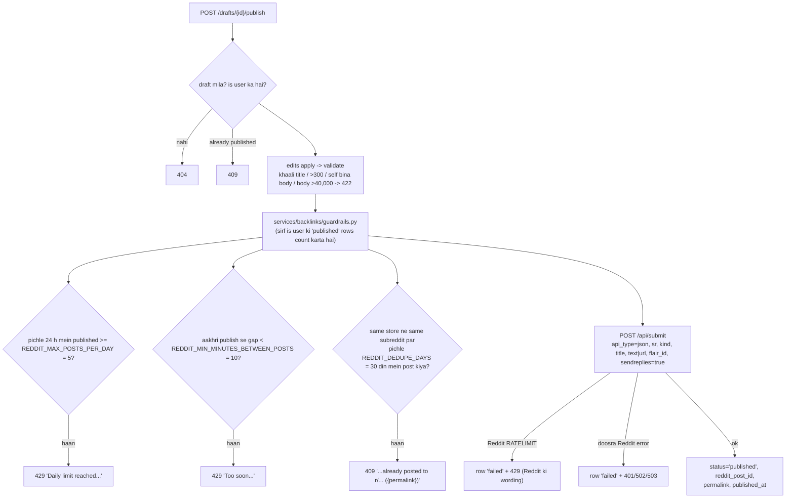

# 06 — Reddit backlink flow (`/auth/reddit/*`, `/api/backlinks/reddit/*`)

**Status: beta.**

**Ek line mein:** ek Reddit account connect karo, wo subreddits dhoondo jahan wo post
kar sakta hai, Gemini ko store ke baare mein ek **rule-aware** post draft karne do, aur
use un **volume guardrails** ke andar publish karo jo account ko Reddit ki terms ke
andar rakhte hain.

> Is domain mein **koi MongoDB nahi** hai. `reddit_posts` table hi draft store bhi hai
> aur guardrail ledger bhi.

**Do rules jo is feature ko shape karte hain** (dono `services/backlinks/backlink_service.py`):

1. **Publish se pehle review** — draft hamesha user ke paas jaata hai.
2. **Reddit ke bolne se pehle local guardrails** — apna rate limit Reddit ke rate limit
   se pehle chalta hai.

---

## 1. Connect karna

Authorization-code grant, HTTP Basic client auth, `duration=permanent`, scopes
`identity submit read mysubreddits flair`, session mein CSRF `state`. **PKCE nahi.**

```mermaid
sequenceDiagram
  participant B as Browser
  participant RT as routes/reddit_auth.py
  participant SV as services/reddit_auth_service.py
  participant R as Reddit
  participant SQL

  B->>RT: GET /auth/reddit/login
  RT->>SV: login(session)
  SV->>SV: user_id create agar missing; session["reddit_oauth_state"]
  SV-->>B: 307 -> reddit.com/api/v1/authorize
  B->>R: authorize
  R-->>B: 302 /auth/reddit/callback?state&code
  B->>RT: GET /auth/reddit/callback
  RT->>SV: callback(session, query_params)
  SV->>SV: state check -> 400 bad state / missing code / expired session
  SV->>R: token exchange (HTTP Basic)
  SV->>R: GET /api/v1/me (username, karma, account age)
  SV->>SQL: UPSERT reddit_credentials
  SV-->>B: 307 -> FRONTEND_URL/?tab=backlink&reddit=connected&username=...
```

| Endpoint | Behaviour | Errors |
|---|---|---|
| `GET /auth/reddit/login` | Reddit consent par redirect | **503** jab `REDDIT_CLIENT_ID`/`SECRET` blank |
| `GET /auth/reddit/callback` | State check → token exchange → `/api/v1/me` → UPSERT → redirect | **400** bad state / missing code / expired session; koi bhi Reddit error → `reddit=error&reason=<ExceptionName>` ke saath redirect |
| `GET /auth/reddit/status` | `{configured, connected, username, link_karma, comment_karma, account_age_days}` **SQL se, koi Reddit call nahi** | — |
| `POST /auth/reddit/disconnect` | Row delete (koi revoke nahi) | — |

> Ye **same** signed-cookie session aur **same** `users` row deliberately reuse karta
> hai jo Google use karta hai — taaki ek browser session ek saath Google Search Console
> aur Reddit dono se connected ho sake.

---

## 2. Reddit client ka behaviour — `integrations/reddit/client.py`

| Concern | Behaviour |
|---|---|
| Token refresh | Proactive (60 s skew), aur 401 par ek baar aur |
| User-Agent | Configured `REDDIT_USER_AGENT` = `web:seo-analyzer:v0.1.0 (by /u/...)`. **Generic UA throttle ho jaata hai** |
| Rate limit | `X-Ratelimit-*` headers capture karta hai |
| Timeout | Har call par 20 s |

### Error mapping (`_http_for`)

| Exception | HTTP |
|---|---|
| `RedditNotConfigured` | 503 |
| `RedditNotConnected` / `RedditAuthError` | 401 |
| `RedditRateLimited` | **429 — Reddit ke apne message ke saath, kabhi retry nahi** |
| Baaki `RedditAPIError` | 502 |

429 par retry **deliberately nahi** hota: Reddit ka rate limit ek account-level signal
hai, aur usse ladna account ban karwa sakta hai.

---

## 3. Discovery

| Endpoint | Kya hota hai | Response |
|---|---|---|
| `GET /subreddits` | `GET /subreddits/mine/moderator?limit=100` + `/subreddits/mine/subscriber?limit=100` (har ek ka **ek** page); subscribed minus moderated; subscribers desc | `{moderated[], subscribed[]}` of `{name, title, subscribers, you_moderate}` |
| `GET /subreddits/{name}/rules` | `/r/{name}/about/rules` + `/r/{name}/about` (**1 h cached**, key `reddit:rules:{name}`); phir `/r/{name}/api/link_flair_v2` (cached nahi; 403 → `[]`) | `{subreddit, rules[], flairs[], self_promo_warning, public_description}` |

**`self_promo_warning`** tab true hota hai jab kisi bhi rule text mein self-promo marker
mile: *self-promo, advertis, no spam, affiliate, vendor, no selling, …*. Frontend
`SubredditRulesPanel` ise ek amber warning box bana deta hai.

---

## 4. Draft banana — `POST /api/backlinks/reddit/drafts`

Body `RedditDraftRequest`:

| Field | Bounds |
|---|---|
| `store_url` | required |
| `subreddit` | `r/` strip hota hai, phir `[A-Za-z0-9_]{1,40}` |
| `angle` | `intro` \| `behind_the_brand` \| `feedback` \| `announcement` \| `helpful` |
| `kind` | `self` \| `link` |
| `flair_id` | optional |
| `extra_notes` | optional, <=2000 chars |
| `auto_publish` | default `false` |

```mermaid
sequenceDiagram
  participant UI
  participant SV as services/backlinks/backlink_service.py
  participant RD as Reddit
  participant ST as Store site
  participant GM as Gemini
  participant SQL

  UI->>SV: POST /drafts
  SV->>SV: require_user (401) + Gemini configured? (503)
  SV->>RD: subreddit rules (cached) + flairs
  SV->>ST: build_store_profile (services/backlinks/store_profile.py):<br/>fetch_page (15 s, 5 MiB) + /products.json?limit=12 (2 MiB)<br/>-> name, tagline, excerpt 1500, is_shopify, 12 products, categories<br/>(1 h cached under store_profile per url)
  SV->>GM: generate_structured(<br/>prompt = angle brief + STORE PROFILE + SUBREDDIT CONTEXT + notes,<br/>schema = RedditDraftSchema, temperature 0.7, 2048 tokens;<br/>invalid JSON par 2 attempts)
  GM-->>SV: {title, body_markdown, suggested_flair_text,<br/>disclosure_included, fit_score 1-5, rule_check_notes[]}
  SV->>SV: validate_draft(): title 1-300, body 1-40,000 -> warna 422
  SV->>SQL: INSERT reddit_posts(status="draft", gemini_model, fit_score, notes, flair)
  alt auto_publish
    SV->>SV: _publish(auto=true) - guardrails + submit
    Note over SV: failure row ko 'failed' mark karta hai aur<br/>`publish` field mein return hota hai - HTTP phir bhi 200
  end
  SV-->>UI: RedditDraftResponse (+ store_profile, publish?)
```

**Synchronous on purpose** — user wait kar raha hai aur result review karega, isliye ye
background job nahi hai.

Errors: **401** · **503** Gemini/Reddit unconfigured · **422** store unreachable ya
`DraftValidationError` · **429** Reddit rate limit · **502** Gemini ya Reddit failure.

Draft generation ka prompt-building code: `services/backlinks/reddit_post_generator.py`.

---

## 5. Guardrails aur publish

`POST /api/backlinks/reddit/drafts/{draft_id}/publish` — body
`RedditPublishRequest{title?, body_markdown?, flair_id?, kind?}`. **Edits validation se
pehle apply hote hain.**



Response `PublishResult{draft_id, status, subreddit, permalink, reddit_post_id,
published_at, auto_published, error_message, ratelimit_remaining}`.

`GET /api/backlinks/reddit/posts?limit=` user ke drafts, published aur failed rows
newest-first list karta hai — **koi Reddit call nahi**.

---

## 6. Data model

Sirf ek table: **`reddit_posts`** (`models/db.py`).

| Column group | Columns |
|---|---|
| Identity | `id` (= draft id), `user_id` |
| Input | `store_url`, `subreddit`, `angle`, `kind` |
| Content | `title`, `body_markdown`, `flair_id`, `flair_text` |
| State | `status` ∈ `draft`/`published`/`failed`, `error_message` |
| Gemini | `fit_score`, `rule_check_notes`, `gemini_model` |
| Result | `reddit_post_id`, `permalink`, `published_at`, `auto_published` |

Ye **ek hi table** draft store, publish log aur guardrail ledger teeno hai — guardrails
isi par query karte hain.

---

## 7. Chhedne se pehle

- **Guardrails ko Reddit ke bharose mat chhodo.** Local limits pehle chalte hain kyunki
  Reddit ka rate limit hit karna account ke liye mehnga hai.
- `REDDIT_USER_AGENT` mein asli username daalo. Default `CHANGE_ME` kehta hai aur
  `placeholder_env_values()` uspar warn karta hai — kyunki generic UA throttle hota hai.
- Reddit app **"web app"** type ka hona chahiye, redirect URI exactly
  `http://localhost:8000/auth/reddit/callback` (dev).
- `auto_publish=true` par bhi HTTP **200** aata hai chahe publish fail ho — failure
  `publish` field ke andar hoti hai. Frontend ise `PublishResult` panel mein dikhata hai.
- Gemini ka Markdown model-generated hai; publish se pehle **hamesha** review path se
  guzrta hai.

---

## Related

- Pipeline contract: [../Pipelines/reddit-pipeline.md](../Pipelines/reddit-pipeline.md)
- Frontend: [../../../frontend-design/docs/Workflow/05-reddit-backlink.md](../../../frontend-design/docs/Workflow/05-reddit-backlink.md)
