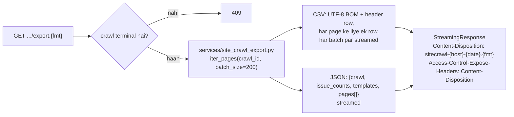
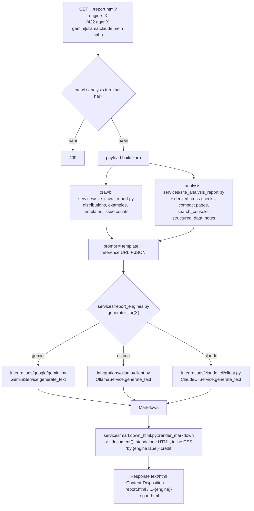
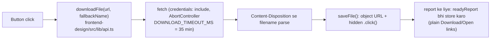

# 07 — Reports aur exports flow

**Ek line mein:** `export.{csv,json}` aur `report.html?engine=` dono **request hone par
banti hain aur stream hoti hain — kabhi store nahi hoti**.

Do families, char endpoints:

| Endpoint | Kya |
|---|---|
| `GET /api/site-crawls/{crawl_id}/export.{csv,json}` | Crawl ka page data |
| `GET /api/site-crawls/{crawl_id}/report.html?engine=` | AI SEO audit report |
| `GET /api/analyses/{analysis_id}/export.{csv,json}` | Spawn hue crawl ka export (delegate) |
| `GET /api/analyses/{analysis_id}/report.html?engine=` | Richer analysis report (crawl + GSC + schema) |

---

## 1. Exports



### Detail

| Cheez | Kyun |
|---|---|
| **Streamed, stored nahi** | Export ek baar maanga jaata hai; har crawl ke liye pre-build karna megabytes rakhega jo koi download nahi karta |
| **UTF-8 BOM (CSV)** | Warna Excel non-ASCII characters mangle kar deta hai |
| **`batch_size=200`** | Pages url ke hisaab se sorted, 200 ke batches mein — poora crawl memory mein nahi aata |
| **`include_navigation=true`** | Wo pages bhi add karta hai jo sirf targets tak pahunchne ke liye fetch hue the |
| **`Access-Control-Expose-Headers`** | Frontend cross-origin hai; iske bina `Content-Disposition` padha hi nahi ja sakta |

**Analysis export wahi stream hai** jo analysis id ke under serve hoti hai —
`site_analysis_service.get_analysis_export` apna `crawl_id` nikalta hai aur
`site_crawl_service.get_site_crawl_export` ko delegate kar deta hai.

Error codes: **409** (crawl terminal nahi / analysis ne crawl produce nahi kiya) ·
**404** (unknown id, ya analysis ka crawl row gayab) · **422** (`fmt` `^(csv|json)$`
pattern se match nahi karta).

---

## 2. AI report — ek pipeline, teen writers

Payload, prompt aur HTML page **same** hain. Sirf ye alag hai ki Markdown **kaun**
likhta hai.



### `services/report_engines.py` — ek hi jagah jo engine names jaanti hai

```python
generator_for(engine) -> TextGenerator   # gemini | ollama | claude
label_for(engine)     -> str             # "Gemini" | "Ollama (qwen3:4b)" | "Claude (fable)"
report_errors_as_http(engine)            # contextmanager: NotConfigured -> 503, baaki -> 502
```

Isi design ki wajah se report **services** aur dono report **routes** engine-agnostic
rehte hain.

---

## 3. Teeno engines ki asli behaviour

| Engine | File | Kaise cope karta hai | Not configured → 503 | Failure → 502 |
|---|---|---|---|---|
| **gemini** (default) | `integrations/google/gemini.py` | 60 s timeout, `max_output_tokens` 8192. Ek 5xx/504 ko 2 s·attempt backoff ke saath **3× retry**, phir `GEMINI_FALLBACK_MODELS` ke neeche **fall back** (`gemini-3.7-flash → 3.6-flash → 3.5-flash-lite`, sab flash-tier key par callable). Ek **4xx retry nahi hota**. Empty reply = `GeminiResponseError` | `GEMINI_API_KEY` set nahi | "Gemini could not generate the report: …" |
| **ollama** | `integrations/ollama/client.py` | `/api/chat`, `stream=false`. `num_ctx` floor 16384 aur **har call par prompt fit karne ke liye grow** hota hai (warna Ollama prompt ko **shuru se** truncate karta hai — yaani hamara system instruction). `think` switch **jaan-boojh kar nahi bheja jaata** (qwen3 par reasoning answer mein leak karta hai) — alag `thinking` field drop hota hai, inline `<think>` strip hota hai. `num_predict` 12288. 1800 s timeout, 10 s connect. Har reply par ek **throughput log line** | `OLLAMA_BASE_URL` blank | unreachable / model pull nahi hua / timeout ("too slow") / empty |
| **claude** | `integrations/claude_cli/client.py` | Koi API key nahi — server par **already logged-in** `claude` command use hoti hai, us account ki subscription par. npm `claude.cmd` shim ko `bin/claude.exe` par resolve karta hai. Run: `--print --output-format json --safe-mode --strict-mcp-config --tools "" --disable-slash-commands --no-session-persistence --system-prompt ...` (+ `--model`/`--effort` agar set). Prompt **stdin par UTF-8 bytes** ke roop mein. Parent session ke `CLAUDE_CODE_*` aur `ANTHROPIC_API_KEY` child env se **strip** hote hain. Fixed empty scratch cwd. Ek waqt mein **ek run** (`asyncio.Lock`). Timeout (900 s) par `taskkill /T`. Login dusre process dwara refresh ho raha ho to **ek retry** | executable nahi mila | CLI `is_error`/non-zero exit (uska message, "log in"/"usage limit" hint ke saath), timeout, JSON nahi, empty result |

### Measured timings (verify kiye gaye)

| Engine | Crawl report | Full-analysis report |
|---|---|---|
| Claude CLI (default `claude-fable-5-1`, effort `xhigh`) | ~198 s | ~462 s |
| Claude CLI, `CLAUDE_CLI_EFFORT=max` | **15 min mein finish nahi hua** — `high` use karo ya effort blank chhodo | — |
| Ollama qwen3:4b CPU-only (~9 tok/s) | ~6 min | 10–15 min |
| Gemini | seconds | seconds |

Isi liye `OLLAMA_TIMEOUT_S = 1800` aur `CLAUDE_CLI_TIMEOUT_S = 900` generous hain —
timeout kaam phenk deta hai.

---

## 4. Security — model ka Markdown untrusted hai

Model ka output ek **untrusted text** hai jo browser mein land karta hai.

`services/markdown_html.py::render_markdown` **raw HTML escape** karta hai. Isliye reply
mein ek `<script>` browser mein **dikhaya** jaata hai, **run nahi** hota.

> Ise mat hatao. Report ek standalone HTML file hai jo user double-click karke kholta
> hai — wahan XSS ka blast radius unki poori machine ka file:// origin hai.

---

## 5. Frontend kaise handle karta hai

Teeno downloads `<a href download>` **nahi** hain — `fetch` hain:



**Kyun fetch:** file tab tak exist hi nahi karti jab tak model likh na de. Anchor page
ko progress dikhane ya failure report karne ka koi tareeka nahi deta. Fetch se button
"Creating report..." keh sakta hai aur ek 502/503 surface kar sakta hai.

**`readyReport` kyun:** jo download click ke **minutes baad** shuru hota hai, use browser
ka "keep this file?" prompt mil sakta hai ya wo bilkul notice hi na ho. Isliye page ek
plain link bhi dikhata hai.

---

## 6. Error codes

| Status | Kab |
|---|---|
| 404 | Unknown crawl/analysis id |
| 409 | Crawl/analysis terminal nahi; ya analysis ne koi crawl produce nahi kiya |
| 422 | `engine` `gemini\|ollama\|claude` mein nahi; `fmt` `csv\|json` nahi |
| 502 | Engine live fail hui (Gemini 5xx retries ke baad, Ollama down/timeout, CLI error) |
| 503 | Engine configured hi nahi (`GEMINI_API_KEY` / `OLLAMA_BASE_URL` blank, `claude` binary nahi mila) |

---

## 7. Chhedne se pehle

- Naya engine add karna ho to **sirf** `services/report_engines.py` (`generator_for`,
  `label_for`, `report_errors_as_http`) aur `schemas`' `ReportEngine` literal chhedo.
  Routes aur report services ko haath lagane ki zaroorat nahi.
- `render_markdown` ka HTML escaping **mat** hatao.
- Claude CLI ek **live subscription** kharch karta hai. Har live run user ke Claude Code
  login ka quota use karta hai.
- `--bare` jaisa koi flag add mat karo — current flag set deliberately tools, MCP,
  slash commands aur session persistence sab disable karta hai.
- Ollama ka `num_ctx` grow logic mat hatao: fixed 4096 window prompt ko **shuru se**
  kaat deta hai, aur system instruction wahi hoti hai jo pehle jaati hai.

---

## Related

- Pipeline contract: [../Pipelines/report-engine-pipeline.md](../Pipelines/report-engine-pipeline.md)
- Frontend: [../../../frontend-design/docs/Workflow/06-downloads-and-reports.md](../../../frontend-design/docs/Workflow/06-downloads-and-reports.md)
