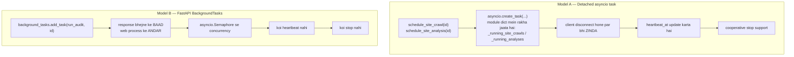
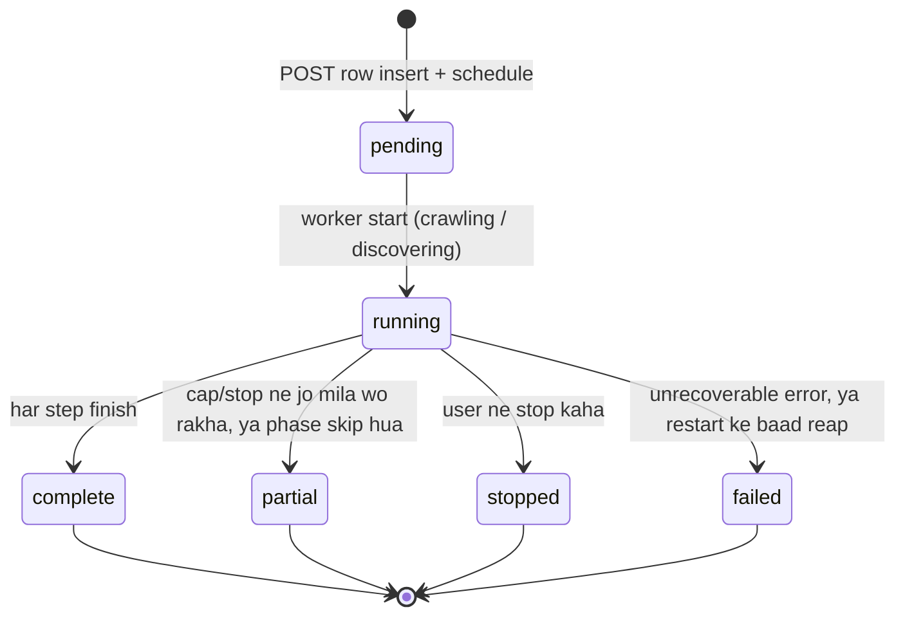
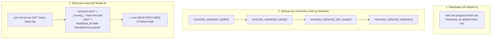
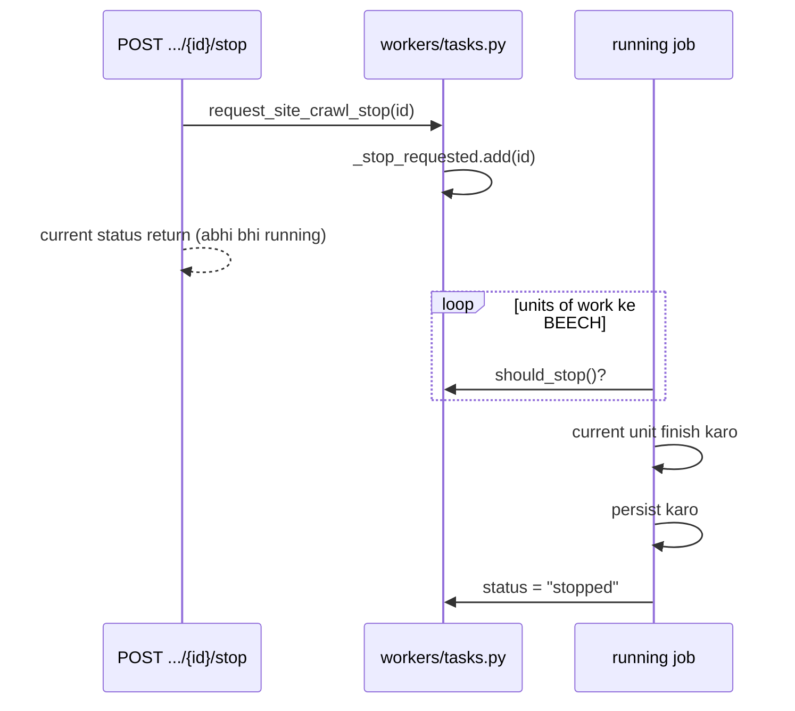
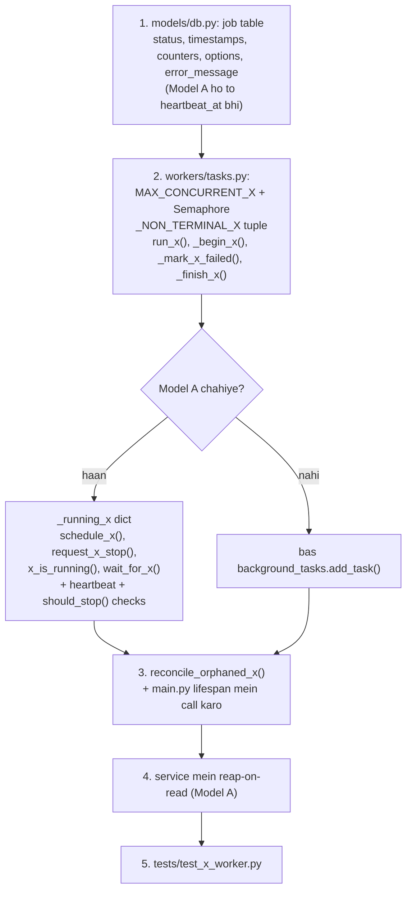

# 08 — Background jobs flow (`workers/tasks.py`)

**Ek line mein:** chaar long-running jobs, do alag job models, aur teen mechanisms jo
"server mar gaya tha" wali atki hui rows ko close karte hain.

`workers/tasks.py` project ki sabse badi file hai (~1,280 lines) aur isme chaaron jobs
rehte hain.

---

## 1. Do job models

**Model A kyun bana:** Model B ke tasks worker ke saath hi mar jaate hain. 20 minute
lene wala crawl us request par depend nahi hona chahiye jisne use shuru kiya tha.

---

## 2. Chaaron jobs ek nazar mein

| Job (function) | Model | Kaun schedule karta hai | Concurrency | Status flow | Stop |
|---|---|---|---|---|---|
| `run_audit` | B | `BackgroundTasks` (row commit ke baad) | `MAX_CONCURRENT_AUDITS = 4` | pending → running → complete \| failed | — |
| `run_store_crawl` | B | `BackgroundTasks` | `MAX_CONCURRENT_CRAWLS = 2` | pending → discovering → enriching → complete \| partial \| failed | — |
| `run_site_crawl` | A | `schedule_site_crawl()` → `_running_site_crawls` | `MAX_CONCURRENT_SITE_CRAWLS = 1` | pending → crawling → complete \| partial \| failed \| stopped | cooperative |
| `run_site_analysis` | A | `schedule_site_analysis()` → `_running_analyses` | `MAX_CONCURRENT_ANALYSES = 1` | status: pending → running → terminal; phase: pending → crawl → gsc → schema → done | cooperative, **crawl tak cascade** |

---

## 3. Shared rules (teeno jobs par lagte hain)

1. **Worker ko sirf row id milti hai.** Request ka `AsyncSession` kabhi background mein
   nahi jaata.
2. **Short sessions.** Worker ek session kabhi bhi network phase ke across hold nahi
   karta — warna SQLite "database is locked" degi.
3. **Done-callbacks** registry entry ko `pop` karte hain, aur agar task ne raise kiya to
   traceback log karte hain.
4. **`wait_for_*` helpers** (`wait_for_site_crawl`, `wait_for_site_analysis`) sirf tests
   aur shutdown ke liye hain — production path inhe use nahi karta.

> **`uvicorn --reload` ke under:** ek file save worker process restart karta hai aur
> **har in-process job kill** kar deta hai. Model A ki rows phir reap-on-read se close
> hoti hain, Model B ki rows agle startup par.

---

## 4. Teen mechanisms: heartbeat, reconcile, reap

Jo worker mar gaya (restart, crash) wo ek row ko `running` mein atka chhod deta hai.
Teen cheezein use close karti hain:

### Reconcile ka behaviour model ke hisaab se alag hai

| Model | Reconcile kya karta hai |
|---|---|
| **B** (audit, store crawl) | **Saari** `pending`/`running` (ya `discovering`/`enriching`) rows **failed** mark ho jaati hain — "The server restarted before this … finished." Koi heartbeat nahi hota, to "zinda hai ya nahi" ka koi tareeka nahi |
| **A** (site crawl, analysis) | Rows **sirf tab** failed mark hoti hain jab koi live task unka owner na ho |

### Stale thresholds

| Constant | Value |
|---|---|
| `SITE_CRAWL_STALE_AFTER_S` | 180 s |
| `ANALYSIS_STALE_AFTER_S` | 300 s |

**Reap-on-read kyun:** taaki client kabhi hamesha ke liye ek ghost ko poll na karta
rahe. Agar sirf startup par reconcile hota, to ek crashed worker ke baad bina restart ke
row hamesha `running` dikhti rehti.

---

## 5. Cooperative stop (sirf Model A)

**`task.cancel()` kabhi nahi** — cancellation data ko mid-write drop kar deti.

Analysis ka stop apne **child crawl** tak forward hota hai:

- Turant, agar crawl start hone ke waqt stop request pehle se pending thi
- Warna ek **side watcher** (`_forward_stop_to_crawl`, `_STOP_WATCH_INTERVAL_S = 1.0 s`)
  ke through, jo use relay karta hai jab `_await_crawl` running crawl par blocked ho

---

## 6. Terminal-status rules (ek table mein)

| Job | `failed` | `partial` | `stopped` | `complete` |
|---|---|---|---|---|
| **Audit** | Fetch error, internal error, ya result save nahi ho saka | — | — | warna |
| **Store crawl** | Kuch bhi discover/enrich nahi hua; robots/catalog/fetch error; ek phase timeout jisme kuch bhi enrich nahi hua | Koi failure, ek abort (5 consecutive 429/503), enrichment cap, ya timeout jisme kuch enrich hua | — | Har planned item attempt hua, koi failure nahi, koi abort nahi |
| **Site crawl** | `pages_fetched == 0`; probe error/timeout; robots disallow | `aborted_reason`, page budget, deadline, depth overflow, transport errors | User stop (pages rakhe jaate hain) | warna |
| **Site analysis** | Crawl start nahi ho saka / koi page fetch nahi hua; "server restarted" reap | Crawl `partial` ya `stopped` par khatam hua | Stop request hua | warna — **note:** jo crawl pages *ke saath* `failed` par khatam hua, wo bhi `complete` report hota hai |

---

## 7. Timing aur budget constants (ek jagah)

| Constant | Value | Kis par |
|---|---|---|
| `MAX_CONCURRENT_AUDITS` | 4 | audit |
| `MAX_CONCURRENT_CRAWLS` | 2 | store crawl |
| `MAX_CONCURRENT_SITE_CRAWLS` | 1 | site crawl |
| `MAX_CONCURRENT_ANALYSES` | 1 | analysis |
| `SITE_PROBE_TIMEOUT_SECONDS` | 30 s | site crawl pre-flight probe |
| `SITE_FLUSH_EVERY_PAGES` / `SITE_FLUSH_EVERY_SECONDS` | 25 pages / 2.0 s | pages → Mongo, counters + heartbeat → SQL |
| `site_crawl_deadline_s` (setting) | 30 min | poore crawl ka wall clock (`deadline_hit` → partial) |
| `TEMPLATE_SAMPLE_CAP` | 600 pages | Lighthouse phase ka sample |
| `MAX_TEMPLATES_TESTED` / `TEMPLATE_CONCURRENCY` / `TEMPLATE_PHASE_TIMEOUT_S` | 8 / 2 / 480 s | per-template Lighthouse (crawl ko **kabhi fail nahi** karta) |
| `DISCOVERY_TIMEOUT_SECONDS` / `CRAWL_TIMEOUT_SECONDS` | 120 s / 1200 s | store crawl phase 1 aur 2 |
| `FLUSH_EVERY_ITEMS` / `FLUSH_EVERY_SECONDS` | 25 / 2.0 s | store crawl enrichment batches |
| `ANALYSIS_CRAWL_WAIT_S` | 35 min (3 s polling) | analysis apne crawl ka wait |
| `MAX_INSPECTIONS` / `INSPECT_CONCURRENCY` / `ANALYTICS_ROW_LIMIT` | 20 / 3 / 100 | analysis GSC phase |
| `SCHEMA_PER_TEMPLATE` / `SCHEMA_MAX_PAGES` | 3 / 12 (512 KiB per fetch) | analysis schema phase |
| `SITE_CRAWL_STALE_AFTER_S` / `ANALYSIS_STALE_AFTER_S` | 180 s / 300 s | reap thresholds |
| `_STOP_WATCH_INTERVAL_S` | 1.0 s | analysis → crawl stop relay |

---

## 8. Naya background job add karna

**Decision rule:** job 30 s se zyada le sakta hai ya stop button chahiye → **Model A**.
Warna Model B kaafi hai.

---

## 9. Chhedne se pehle

- Worker mein **lamba session** mat holdo. Har network phase ke beech session band karo.
- Naya Model A job bana rahe ho to `reconcile_orphaned_*` **aur** reap-on-read dono
  likhna — ek ke bina row ghost ban jaayegi.
- `MAX_CONCURRENT_*` badhane se pehle soch lo ki har concurrent job kitni outbound calls
  karta hai aur target site par kitna load daalta hai.
- Existing job table mein naya column add karo to use **nullable** rakho (koi Alembic
  nahi hai — `db/session.py::_add_missing_columns` sirf nullable/server-default columns
  add kar sakta hai).

---

## Related

- Har job ka apna flow: [01](01-audit-flow.md) · [02](02-site-crawl-flow.md) · [03](03-site-analysis-flow.md) · [04](04-store-catalog-flow.md)
- Data model: [../Reference/data-model.md](../Reference/data-model.md)
