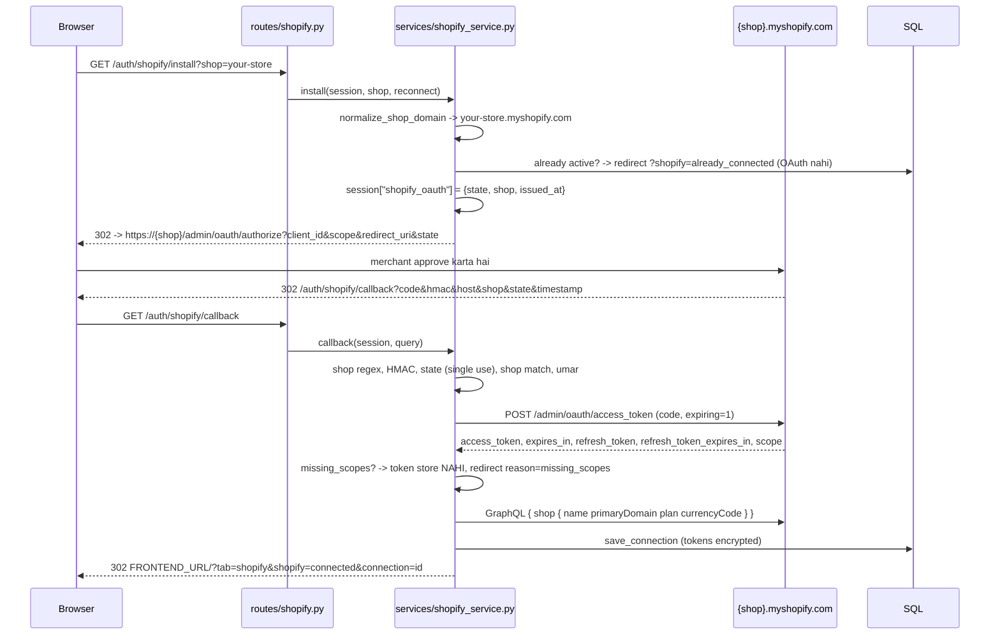
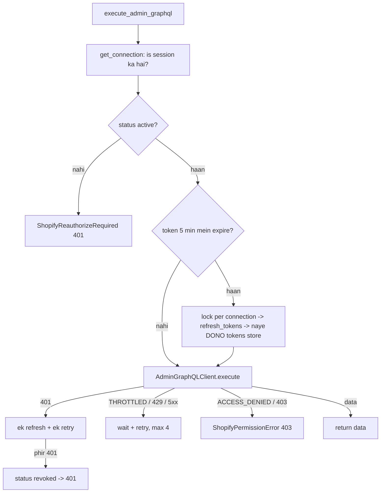

# 09 — Shopify connection flow (`/auth/shopify/*`, `/api/shopify/*`)

**Ek line mein:** merchant apna `*.myshopify.com` store connect karta hai, Shopify
khud permission maangta hai, aur uske baad backend us store ka Admin GraphQL API
store ke apne access token se call kar sakta hai, jo khud refresh hota rehta hai.

> Ye **site crawler se alag** feature hai. Crawler public data hi padhta hai (koi
> token nahi); ye connection sirf un stores ke liye hai jinka owner approve karta hai.

**Teen rules jo is feature ko shape karte hain:**

1. **Token kabhi browser tak nahi jaata.** Koi schema mein token ka field hi nahi hai,
   aur generic GraphQL passthrough endpoint jaan-boojh kar nahi banaya.
2. **Token at rest encrypted.** `shopify_connections` mein ciphertext hai
   (Fernet, key `SHOPIFY_TOKEN_ENCRYPTION_KEY` se HKDF karke). `seo.db` ki copy kisi
   store ka admin access nahi deti.
3. **Callback ka har check pass ho, tabhi code use hota hai**: shop format, HMAC,
   state, shop match, state ki umar (15 min).

---

## 1. Connect karna

Authorization code grant, standalone app. Token exchange `expiring=1` ke saath hota
hai: access token 60 minute ka, refresh token 90 din ka aur **har refresh par
rotate** hota hai. Naye public apps ke liye GraphQL Admin API par yahi zaroori hai, aur
2027-01-01 se non-expiring tokens public apps ke liye band ho jaate hain.



**Shop domain normalisation** (`integrations/shopify/oauth.py::normalize_shop_domain`)
`your-store`, `your-store.myshopify.com`, `https://your-store.myshopify.com/admin` aur
`https://admin.shopify.com/store/your-store` sab `your-store.myshopify.com` ban jaate
hain. Custom domain (`www.example.com`), port, IP, userinfo — sab reject, **koi request
bheje bina**. Isi wajah se code exchange kabhi kisi arbitrary host par nahi jaa sakta.

**HMAC:** `hmac` (aur `signature`) ko chhod kar baaki saare params sort karke
`key=value&...` join, client secret se HMAC-SHA256, hex, `hmac.compare_digest`.

**Callback failure** hamesha frontend par redirect hai (JSON nahi, kyunki ye browser
navigation hai), ek fixed `reason` ke saath:

| `reason` | Kab |
|---|---|
| `invalid_shop` | domain myshopify.com nahi |
| `not_configured` | client id/secret ya encryption key missing |
| `invalid_hmac` | signature verify nahi hua |
| `invalid_state` | state session wale se match nahi |
| `shop_mismatch` | callback kisi aur store se aaya |
| `state_expired` | 15 min se zyada lage |
| `denied` | Shopify ne `error` bheja |
| `missing_code` / `session_expired` | code ya session gayab |
| `token_exchange_failed` | Shopify ne code reject kiya (use ho chuka, expire, galat secret) |
| `missing_scopes` | grant mein maange gaye scopes kam; `missing=` param ke saath |
| `unreachable` / `shopify_error` | network ya Shopify 5xx |

## 2. GraphQL call karna — reusable entry point

```python
from services.shopify_service import execute_admin_graphql

data = await execute_admin_graphql(user_id, connection_id, QUERY, {"first": 10})
```



- **Refresh ek waqt mein ek** (`asyncio.Lock` per connection). Shopify har refresh par
  refresh token rotate karta hai; do saath chale to ek ke paas wo token reh jaata jo
  doosra replace kar chuka. Lock ke andar latest row dobara padhte hain: kisi aur ne
  refresh kar diya ho to wahi token use hota hai.
- **Refresh 400/401 final hai** — Shopify expired, replaced, revoked token aur
  uninstalled app sabke liye ek hi jawab deta hai, isliye retry nahi, seedha
  `reauthorize_required`.
- **Transient refresh failure** (network, 429, 5xx) usi refresh token ke saath 3 baar.
  Agar access token ke abhi minute bache hain to wahi use hota hai.
- **Throttling** cost-based hai: `THROTTLED` error ke `extensions.cost.throttleStatus`
  se exact wait nikalta hai (`(requestedQueryCost - currentlyAvailable) / restoreRate`,
  0.5–20 s).

## 3. Statuses

| `status` | Matlab | UI |
|---|---|---|
| `active` | token kaam karta hai | products dikhte hain |
| `reauthorize_required` | refresh token expire/reject, ya encryption key badal gayi | Reconnect |
| `revoked` | Shopify ne **fresh** token bhi reject kiya: app uninstall ya access withdraw | Reconnect |

`POST /connections/{id}/check` abhi API call karke status sach karta hai; jo connection
reconnect maangta hai wo 200 mein apne naye status ke saath aata hai, error nahi.

## 4. Disconnect

Dono tokens app se delete. App ko store se **uninstall nahi** karta — wo irreversible
hai aur store ki configuration hata deta hai, ye merchant ka faisla hai (Shopify admin >
Apps). Refresh token ke bina aakhri access token ek ghante mein lapse ho jaata hai.

## 5. Endpoints

| Method | Path | Kya | Status codes |
|---|---|---|---|
| GET | `/auth/shopify/app` | App URL: frontend ke Shopify section par redirect | 302 |
| GET | `/auth/shopify/install?shop=&reconnect=` | Shopify permission prompt par redirect | 302 |
| GET | `/auth/shopify/callback` | checks, code exchange, store | 302 |
| GET | `/api/shopify/status` | configured? + is session ke connections | 200 |
| POST | `/api/shopify/connections/{id}/check` | abhi API call karke status | 200, 404, 429, 502, 503 |
| GET | `/api/shopify/connections/{id}/products?first=&after=&q=` | products (cursor paging) | 200, 401, 403, 404, 429, 502, 503 |
| POST | `/api/shopify/connections/{id}/disconnect` | credentials delete | 200, 404 |

Doosre session ka connection id hamesha **404** hai — ownership leak nahi hoti.

## 6. Files

| File | Kaam |
|---|---|
| `routes/shopify.py` | do routers: `/auth/shopify`, `/api/shopify` |
| `controller/shopify.py` | `http_for`: domain error -> HTTP, ek hi jagah |
| `services/shopify_service.py` | install, callback, refresh-aware `execute_admin_graphql`, products, check, disconnect |
| `integrations/shopify/oauth.py` | domain normalise, authorize URL, HMAC, code exchange, refresh, scope check |
| `integrations/shopify/admin_graphql.py` | `AdminGraphQLClient`: retries, throttle wait, error mapping |
| `integrations/shopify/credentials.py` | `shopify_connections` read/write, encrypt/decrypt |
| `integrations/shopify/crypto.py` | Fernet + HKDF |
| `exceptions/shopify.py` | domain errors |
| `models/db.py::ShopifyConnection` | table, unique `(user_id, shop_domain)` |
| `tests/test_shopify_connection.py` | 42 tests, Shopify respx se mock |

## 7. Setup

1. Shopify Dev Dashboard mein app banao. App > Versions > Create a version mein:
   - **App URL**: `http://localhost:8000/auth/shopify/app`
   - **Redirect URLs**: `SHOPIFY_REDIRECT_URI` exactly (`http://localhost:8000/auth/shopify/callback`)
   - **Embed app in Shopify admin**: off (ye standalone app hai)
   - Scopes: `read_products`
   phir version **Release** karo.

   > Shopify maangta hai ki App URL aur redirect URL ka **host same** ho. Warna
   > authorize page par *"redirect_uri and application url must have matching
   > hosts"* aata hai aur merchant hamare callback tak pahunchta hi nahi.
   > `/auth/shopify/app` sirf frontend ke Shopify section par bhejta hai — jab
   > merchant Shopify admin se app kholta hai to wahi khulta hai.
2. `server/.env`: `SHOPIFY_CLIENT_ID`, `SHOPIFY_CLIENT_SECRET`,
   `SHOPIFY_TOKEN_ENCRYPTION_KEY` (lamba random string), zaroorat ho to `SHOPIFY_SCOPES`.
3. Server restart, Shopify section mein `your-store.myshopify.com` daal kar Connect.

Scopes baad mein badle to purane connections par `missing_scopes` dikhta hai aur UI
Reconnect maangta hai.
