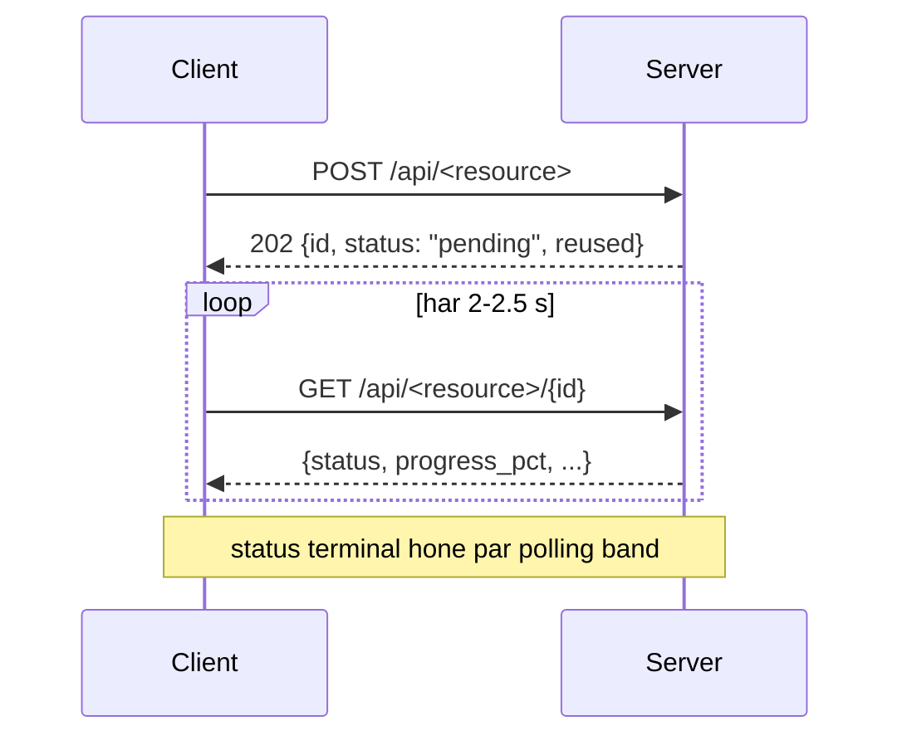

# Pipelines — API ka contract aur budget

`Flows/` batata hai **kaun kisko call karta hai**.
`Pipelines/` batata hai **kya bhejo, kya milega, aur limits kya hain**.

Agar aap ek API consume kar rahe ho (frontend, script, ya koi doosra service), to
yahi folder aapka reference hai.

---

## Index

| File | Kya cover karta hai |
|---|---|
| [endpoint-index.md](endpoint-index.md) | **Saare** endpoints ek table mein — router, method, path, maqsad, status codes |
| [audit-pipeline.md](audit-pipeline.md) | `/api/audits` |
| [site-crawl-pipeline.md](site-crawl-pipeline.md) | `/api/site-crawls` |
| [site-analysis-pipeline.md](site-analysis-pipeline.md) | `/api/analyses` |
| [store-catalog-pipeline.md](store-catalog-pipeline.md) | `/api/stores` |
| [gsc-pipeline.md](gsc-pipeline.md) | `/auth/*`, `/api/sites`, `/api/search-analytics`, `/api/gsc/*` |
| [reddit-pipeline.md](reddit-pipeline.md) | `/auth/reddit/*`, `/api/backlinks/reddit/*` |
| [report-engine-pipeline.md](report-engine-pipeline.md) | `report.html?engine=` aur `export.{csv,json}` |

---

## Conventions jo har pipeline share karti hai

### 1. Async job = 202 + poll



**Terminal statuses:** `complete`, `partial`, `failed`, `stopped`.

| Status | Matlab |
|---|---|
| `complete` | Sab kuch chala |
| `partial` | Kuch mila, par ek cap/deadline/failure ne use adhoora chhoda — **data valid hai** |
| `stopped` | User ne stop kaha — **jo mila wo rakha gaya**, ye failure nahi hai |
| `failed` | Kuch useful nahi mila |

### 2. `reused: true`

Har job-creating `POST` **in-flight dedupe** karta hai: us host/domain ka ek job pehle
se chal raha hai to naya row nahi banta, purana `id` wapas milta hai aur `reused=true`
set hota hai. Client ko kuch alag nahi karna — bas wahi id poll karo.

### 3. Mid-flight counts under-report karte hain

Jab tak job terminal na ho, counts kam dikhenge:

- Pages/items **batches** mein likhe jaate hain
- `orphan` sirf tab exist karta hai jab **poora graph** pata ho
- `only_gaps` filter phase-1 docs ko miss karta hai (unpar abhi flags nahi)

**Terminal status ka wait karo**, phir hi numbers final maano.

### 4. Downloads on demand

`export.csv|json` aur `report.html` request hone par **banti** hain, kabhi store nahi
hoti. Dono set karte hain:

```
Content-Disposition: attachment; filename="..."
Access-Control-Expose-Headers: Content-Disposition
```

CSV UTF-8 BOM se shuru hoti hai taaki Excel use sahi kholе.

### 5. Session cookie = identity

Koi API key nahi, koi login screen nahi. Har request `credentials: "include"` ke saath
jaani chahiye — signed `session` cookie hi Google/Reddit connection carry karti hai.

### 6. Error codes

| Status | Condition |
|---|---|
| 400 | User ke connections par precondition (jaise GSC ke bina analysis) |
| 403 | Target site ka robots.txt crawler ko disallow karta hai |
| 404 | Unknown id |
| 409 | Job abhi terminal nahi hua, ya resource already published |
| 422 | Validation (body, query `Literal`, regex path param) |
| 429 | Reddit rate limit ya local guardrail |
| 502 | Upstream live fail hui (Gemini/Ollama/Claude CLI/Reddit/Google 5xx) |
| 503 | Feature configured hi nahi, ya MongoDB unreachable |

Poori list: [../Reference/error-codes.md](../Reference/error-codes.md).
