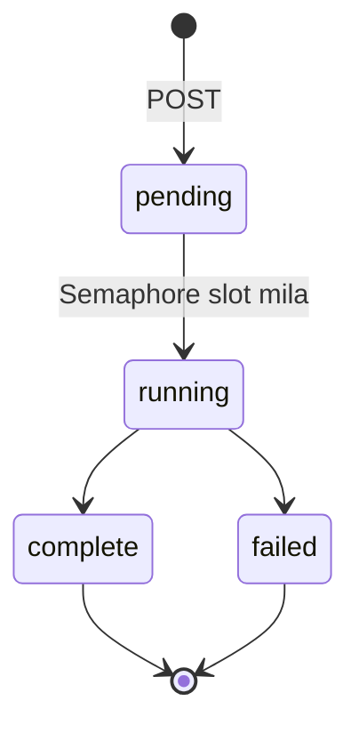

# Audit pipeline — `/api/audits`

Single-page audit: ek URL, ek fetch, paanch analyzers, ek score.

Code flow: [../Flows/01-audit-flow.md](../Flows/01-audit-flow.md)

---

## Contract

### `POST /api/audits` → **202**

```json
{ "url": "example.com/product/widget" }
```

| Field | Rules |
|---|---|
| `url` | 1–2048 chars; trim hota hai; scheme na ho to `https://` prefix; sirf http/https; host mein `.` hona chahiye **ya** `localhost` hona chahiye |

Response:

```json
{ "audit_id": "..." }
```

### `GET /api/audits/{audit_id}` → **200**

```json
{
  "audit_id": "...",
  "url": "https://example.com/product/widget",
  "status": "complete",
  "created_at": "...",
  "completed_at": "...",
  "overall_score": 78.4,
  "grade": "C",
  "categories": [
    { "name": "on_page", "score": 82.0, "analyzers": [ /* AnalyzerReport */ ] }
  ],
  "prioritized_fixes": [ /* Finding + analyzer + category, max 10 */ ],
  "page": {
    "requested_url": "...", "final_url": "...", "status_code": 200,
    "load_time_ms": 412.0, "fetched_at": "...", "redirect_chain": [], "truncated": false
  },
  "error": null
}
```

> `overall_score` aur `status` ke alawa **sab kuch** `results_json` column se aata hai.
> Job abhi chal raha hai to `categories` aur `prioritized_fixes` khaali arrays hain —
> 404 nahi.

### `AnalyzerReport`

```json
{
  "analyzer": "on_page",
  "category": "on_page",
  "score": 82.0,
  "findings": [ /* Finding */ ],
  "duration_ms": 14.2,
  "error": null
}
```

### `Finding`

```json
{
  "id": "on_page.title_length",
  "severity": "warning",
  "title": "...",
  "description": "...",
  "recommendation": "...",
  "impact": 4,
  "effort": 2,
  "evidence": { }
}
```

`severity` ∈ `critical` \| `warning` \| `info` \| `passed`.
`impact` aur `effort` 1–5.

---

## States



| Status | Matlab |
|---|---|
| `pending` | Row ban gayi, `MAX_CONCURRENT_AUDITS = 4` slot ka wait |
| `running` | Fetch + analyzers chal rahe hain |
| `complete` | Report ban gayi |
| `failed` | `FetchError`, internal error, ya result save nahi ho saka. `error` field batata hai |

**Koi `partial`, koi `stopped`, koi stop endpoint nahi.**

---

## Scoring

```
analyzer score  = max(0, 100 - sum(deductions))
                  critical = 20, warning = 8, info = 0, passed = 0

category score  = us category ke analyzers ka WEIGHTED MEAN
                  (score=None wale EXCLUDE; har analyzer ka weight 1.0)

overall score   = sab analyzers ka weighted mean

grade           = A >= 90, B >= 80, C >= 70, D >= 60, warna F

prioritized_fixes = har non-passed finding
                    sort: severity, phir impact DESC, phir effort ASC
                    cap 10
```

Do exceptions: `pagespeed` ka score Lighthouse performance score hai; `content_ai` ka
score model ka intent-match score hai.

---

## Paanch analyzers

| Analyzer | Category | Kya check karta hai | External call | Skip kab |
|---|---|---|---|---|
| `on_page` | `on_page` | title (missing=critical, 30–60 chars), meta description 70–160, bilkul ek H1, heading level skips, image alt coverage, >=1 internal link, canonical, og:title/description/image, >=300 words, `<html lang>` | — | kabhi nahi |
| `technical` | `technical` | 2xx pass / >=400 critical, redirects 0/1/2+, HTTPS, response time <800 ms / <2500 ms, robots.txt 200, noindex (meta ya `X-Robots-Tag`) critical, viewport, charset, favicon | — | kabhi nahi |
| `pagespeed` | `performance` | performance >=90/>=50, LCP <=2.5 s / >4 s, INP <=200 ms / >500 ms, CLS <=0.1 / >0.25. **CrUX field data lab values se prefer** | PSI v5, 60 s timeout, 1 h cached (`psi:{strategy}:{categories}:{url}`) | `PAGESPEED_API_KEY` blank |
| `content_ai` | `content` | main text (nav/footer/aside strip, <=8000 chars, >=25 words) → intent match, E-E-A-T, gaps (<=5), rewrite, summary | Anthropic `complete_json`, max 1500 tokens, 3 retries on 408/409/429/5xx | `ANTHROPIC_API_KEY` blank |
| `search_console` | `search_performance` | best-matching property, 28-din window (2-din lag), page-wise + page+query (25 rows). Findings: no data, summary, top queries, low CTR (impr>=100, CTR<2%, pos<=20.5), striking distance (pos 10.5–20.5, impr>=50) | Search Console API, 1 h cached, rows Mongo mein mirror | Google connected nahi |

**Skip hone par analyzer `score=None` return karta hai** aur ek explanatory finding —
wo category se exclude ho jaata hai, zero nahi ginta.

**Ek analyzer kabhi raise nahi karta:** `BaseAnalyzer.analyze` har exception ko
`AnalyzerResult(score=None, error="Type: msg")` bana deta hai.

> `SITE_CRAWL_ANALYZERS` setting audits ko **affect nahi karti** — audit hamesha paanchon
> chalaata hai.

---

## Fetch budget

| Cheez | Value | Kahan |
|---|---|---|
| Timeout | 15 s | `services/crawler/fetcher.py::TIMEOUT_SECONDS` |
| Redirects | <=5 | `MAX_REDIRECTS` |
| Body cap | 5 MiB | `fetcher.py` |
| Content type | sirf HTML | `fetcher.py` |
| robots.txt | 5 s, 512 KiB | `fetcher.py` |

Cap hit hua to `page.truncated = true` aata hai — matlab neeche ke counts (words,
images, links) **lower bounds** hain.

---

## Errors

| Status | Kab |
|---|---|
| 202 | Audit create ho gaya |
| 404 | Unknown `audit_id` ("Audit not found") |
| 422 | URL validation fail |

Fetch fail hone par **404/422 nahi** aata — audit `failed` status ke saath `complete`
hota hai aur `error` field mein wajah hoti hai. Client ko polling se hi pata chalta hai.

---

## Polling

Frontend har **2000 ms** par poll karta hai
(`frontend-design/src/state/auditStore.ts::POLL_MS`). Terminal status par poller ruk
jaata hai.

---

## Concurrency aur restart

| Cheez | Value |
|---|---|
| Concurrency | `MAX_CONCURRENT_AUDITS = 4` (`asyncio.Semaphore`) |
| Heartbeat | **Nahi** |
| Stop | **Nahi** |
| Restart par | `reconcile_orphaned_audits()` har `pending`/`running` row ko **failed** mark karta hai: "The server restarted before this audit finished." |
