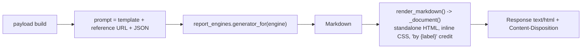

# Report aur export pipeline

`GET .../export.{csv,json}` · `GET .../report.html?engine=`

Code flow: [../Flows/07-report-and-export-flow.md](../Flows/07-report-and-export-flow.md)

**Core rule:** dono **request hone par banti hain aur stream hoti hain — kabhi store
nahi hoti.**

---

## 1. Exports — `export.{csv,json}`

| Endpoint | |
|---|---|
| `GET /api/site-crawls/{crawl_id}/export.{csv,json}` | Crawl ka page data |
| `GET /api/analyses/{analysis_id}/export.{csv,json}` | **Crawl export ko delegate** karta hai |

| Param | Values | Default |
|---|---|---|
| `fmt` (path) | regex `^(csv\|json)$` | — |
| `include_navigation` (query) | bool | `false` |

### CSV

- UTF-8 **BOM** se shuru (warna Excel non-ASCII mangle karta hai)
- Header row, phir har page ke liye ek row
- `iter_pages(crawl_id, batch_size=200)` — url ke hisaab se sorted, 200 ke batches,
  har batch par stream flush

### JSON

```json
{ "crawl": { }, "issue_counts": { }, "templates": [ ], "pages": [ ] }
```

Streamed, poora memory mein nahi aata.

### Headers

```
Content-Disposition: attachment; filename="sitecrawl-{host}-{date}.{fmt}"
Access-Control-Expose-Headers: Content-Disposition
```

Doosra header **zaroori** hai — frontend cross-origin hai, uske bina filename padha hi
nahi ja sakta.

### Errors

| Status | Kab |
|---|---|
| 404 | Unknown id; ya analysis ka crawl row gayab |
| 409 | Crawl/analysis terminal nahi; ya analysis ne koi crawl produce nahi kiya |
| 422 | `fmt` `csv` ya `json` nahi |

---

## 2. AI report — `report.html?engine=`

| Endpoint | Payload |
|---|---|
| `GET /api/site-crawls/{crawl_id}/report.html?engine=` | Crawl: distributions, examples, templates, issue counts |
| `GET /api/analyses/{analysis_id}/report.html?engine=` | **+** derived cross-checks, compact pages, `search_console`, `structured_data`, `notes` |

| Param | Values | Default |
|---|---|---|
| `engine` | `gemini` \| `ollama` \| `claude` | `gemini` |

**Ek pipeline, teen writers.** Payload, prompt aur HTML page same hain — sirf Markdown
kaun likhta hai wo alag hai.



Filename: `...-report.html` (gemini) ya `...-{engine}-report.html`.

---

## 3. Teen engines

### `gemini` (default)

`integrations/google/gemini.py`

| Cheez | Value |
|---|---|
| Timeout | 60 s |
| `max_output_tokens` | 8192 |
| 5xx/504 par | **3× retry**, 2 s·attempt backoff |
| Phir | `GEMINI_FALLBACK_MODELS` ke neeche fall back |
| 4xx par | **Retry nahi** |
| Empty reply | `GeminiResponseError` |

Fallback chain (default): `gemini-3.7-flash` → `gemini-3.6-flash` → `gemini-3.5-flash-lite`.
Ye alag flash deployments hain, to ek par capacity spike aane par sab par aana rare hai;
aakhri ek lite model hai jo lagbhag hamesha free hota hai. Blank karne par fallback off,
aur primary model ka error jaisa ka taisa surface hota hai.

Not configured (`GEMINI_API_KEY` blank) → **503**.

### `ollama`

`integrations/ollama/client.py` — local model server.

| Cheez | Value / behaviour |
|---|---|
| Endpoint | `POST {OLLAMA_BASE_URL}/api/chat`, `stream=false` |
| `num_ctx` | Floor `OLLAMA_NUM_CTX = 16384`, **har call par prompt fit karne ke liye grow** hota hai |
| `num_predict` | 12288 |
| Timeout | `OLLAMA_TIMEOUT_S = 1800` s; connect 10 s |
| `think` switch | **Jaan-boojh kar nahi bheja jaata** — qwen3 par reasoning answer mein leak karta hai. Alag `thinking` field drop hota hai, inline `<think>` strip hota hai |
| Logging | Har reply par ek throughput log line |

> **`num_ctx` grow logic mat hatao.** Ollama ki default window 4096 tokens hai aur wo
> lambe prompt ko **shuru se** truncate karta hai — yaani hamara system instruction
> sabse pehle kat jaata hai.

Not configured (`OLLAMA_BASE_URL` blank) → **503**.
Failures → **502**: unreachable, model pull nahi hua (Ollama ka apna 404 text), timeout
("too slow"), empty reply.

### `claude`

`integrations/claude_cli/client.py` — **koi API key nahi**. Report server par pehle se
logged-in `claude` command likhti hai, us account ki subscription par.

| Cheez | Behaviour |
|---|---|
| Path resolve | `CLAUDE_CLI_PATH` (command name ya full path). npm `claude.cmd` shim → `bin/claude.exe` |
| Flags | `--print --output-format json --safe-mode --strict-mcp-config --tools "" --disable-slash-commands --no-session-persistence --system-prompt …` (+ `--model` / `--effort` agar set) |
| Prompt | **stdin par UTF-8 bytes** |
| Env | Parent session ke `CLAUDE_CODE_*` aur `ANTHROPIC_API_KEY` **strip** hote hain |
| cwd | Fixed empty scratch directory |
| Concurrency | **Ek waqt mein ek run** (`asyncio.Lock`) |
| Timeout | `CLAUDE_CLI_TIMEOUT_S = 900` s → `taskkill /T` (poora process tree) |
| Retry | **Ek** retry jab login kisi doosre process dwara refresh ho raha ho |

Not configured (binary nahi mila) → **503** with install/login hint.
Failures → **502**: CLI `is_error`/non-zero exit (uska apna message, "log in" ya "usage
limit" hint ke saath), timeout, JSON nahi, empty result.

---

## 4. Measured timings (verify kiye gaye)

| Engine | Crawl report | Full-analysis report |
|---|---|---|
| Gemini | seconds | seconds |
| Claude CLI (default `claude-fable-5-1`, effort `xhigh`) | **~198 s** | **~462 s** |
| Claude CLI, `CLAUDE_CLI_EFFORT=max` | **15 min mein finish nahi hua** | — |
| Ollama qwen3:4b, CPU-only (~9 tok/s) | ~6 min | 10–15 min |

> `CLAUDE_CLI_EFFORT=max` **mat** use karo — `high` use karo ya blank chhod do (CLI ka
> apna default).

Isiliye timeouts generous hain: ek timeout poora kaam phenk deta hai.

---

## 5. Security — model ka output untrusted hai

`services/markdown_html.py::render_markdown` **raw HTML escape karta hai**.

Isliye model ke reply mein ek `<script>` browser mein **dikhaya** jaata hai, **run nahi**
hota.

> Ise mat hatao. Report ek standalone HTML file hai jo user double-click karke kholta
> hai — wahan XSS ka blast radius unki poori machine ka `file://` origin hai.

---

## 6. Errors (dono families)

| Status | Kab |
|---|---|
| 404 | Unknown crawl/analysis id |
| 409 | Terminal nahi; ya analysis ne crawl produce nahi kiya |
| 422 | `engine` `gemini\|ollama\|claude` mein nahi; `fmt` `csv\|json` nahi |
| 502 | Engine live fail hui |
| 503 | Engine configured hi nahi |

`report_errors_as_http(engine)` contextmanager (`services/report_engines.py`) hi ye
mapping karta hai — ek jagah, sab engines ke liye.

---

## 7. Client-side contract

Teeno downloads `<a href download>` **nahi** ho sakte — file tab tak exist hi nahi karti
jab tak server use likh na de.

```js
// frontend-design/src/lib/api.ts
const DOWNLOAD_TIMEOUT_MS = 35 * 60 * 1000;   // 35 minutes

const response = await fetch(url, {
  credentials: "include",
  signal: controller.signal,
});
const disposition = response.headers.get("content-disposition") ?? "";
const match = /filename="?([^";]+)"?/i.exec(disposition);
```

35 minutes isliye ki server khud usse pehle give up kar deta hai (Claude CLI 15 min,
Ollama 30 min) — timeout hit hona matlab connection hi mar gaya (worker restart), aur
button ko "Creating report..." par hamesha nahi baithna chahiye.

**Report ke liye `readyReport` bhi rakha jaata hai** — ek download jo click ke
**minutes baad** shuru hota hai use browser ka "keep this file?" prompt mil sakta hai
ya wo notice hi na ho. Isliye page ek plain Download/Open link bhi dikhata hai.

---

## 8. Naya engine add karna

Sirf **do** jagah chhedni hain:

1. `schemas/` ka `ReportEngine` literal
2. `services/report_engines.py` — `generator_for()`, `label_for()`,
   `report_errors_as_http()`

Routes aur report services engine-agnostic hain — unhe haath lagane ki zaroorat nahi.

Naya engine ko bas ye protocol satisfy karna hai:

```python
class TextGenerator(Protocol):
    async def generate_text(self, *, prompt: str, system_instruction: str) -> str: ...
```

---

## 9. Jaanne layak gap — analysis report ka `derived` block

`services/site_analysis_report.py::build_analysis_payload` ek `export` argument accept
karta hai (crawl ka **full page export**) taaki `derived` cross-checks compute kar sake:
duplicate titles, identical/empty/thin pages, canonical groups, per-template bands.

**Service abhi wo export pass nahi karti.** `_find_export` payload ki pehli pages-jaisi
list par fall back karta hai: `example_pages`, **zyada se zyada 8 rows**.

Matlab: jab tak service real export supply nahi karti, `derived` sirf un 8 examples ko
describe karta hai, **poore crawl ko nahi** — aur jab koi bhi na ho to
`{"available": false}`.

Fix: `site_analysis_service` se `site_crawl_export.iter_pages(...)` ka output
`build_analysis_payload(export=...)` mein pass karo.
