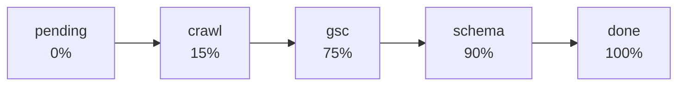
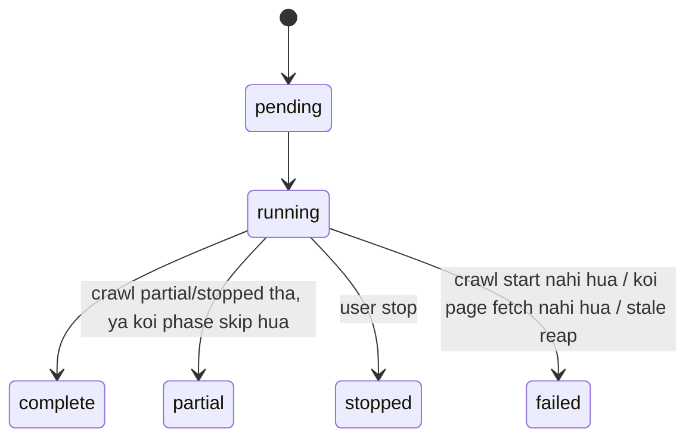

# Full analysis pipeline — `/api/analyses`

Ek run jo store crawl karta hai, har page score karta hai, Search Console se performance
aur indexation padhta hai, per-template Lighthouse measure karta hai, aur structured data
check karta hai.

Code flow: [../Flows/03-site-analysis-flow.md](../Flows/03-site-analysis-flow.md)

---

## 1. `POST /api/analyses` → **202**

```json
{
  "start_url": "example.com",
  "max_pages": 150,
  "max_depth": 3,
  "page_types": []
}
```

Body = `SiteAnalysisCreateRequest` — site crawl ke **wahi** crawler fields
(`crawl_options()` unhe crawl ke options mein badal deta hai).

| Field | Bounds | Note |
|---|---|---|
| `start_url` | 1–2048 | required |
| `max_pages` | 0–5000 | **0 = koi page cap nahi** (form ka "All pages") |
| `max_depth` | 0–10 | |
| `page_types` | `[]` / `["product"]` / `["collection"]` / dono | |
| `include_subdomains`, `follow_nofollow`, `seed_from_sitemap` | bool | crawl jaisa |

> `max_pages = 0` par depth limit aur crawl ki 30-minute deadline **phir bhi** apply
> hote hain — isliye ek bahut bada store hamesha ke liye chalne ke bajaye `deadline_hit`
> ke saath `partial` par khatam hota hai.

### GSC gate — **400**

`gsc_connected(user_id)` **true hona zaroori hai**. Warna:

```
400 "Connect Google Search Console before running a full store analysis."
```

Kyun: ye pipeline hi GSC ko fold-in karne ke liye exist karti hai. Bina uske report ka
ek-tihai hissa chupchaap missing reh jaata.

Response:

```json
{ "analysis_id": "...", "start_url": "https://example.com",
  "host": "example.com", "status": "pending", "reused": false }
```

---

## 2. Phases aur progress



| `phase` | Kya ho raha hai | Typical time | Fail hone par |
|---|---|---|---|
| `pending` | Slot ka wait (`MAX_CONCURRENT_ANALYSES = 1`) | — | — |
| `crawl` | Site crawl spawn + poll (max `ANALYSIS_CRAWL_WAIT_S = 35 min`) | minutes | **Analysis `failed`** |
| `gsc` | Search Analytics ×2 + URL Inspection sample | ~30–60 s | `gsc_error` set, analysis chalti rehti hai |
| `schema` | <=12 pages fetch + JSON-LD parse | ~10–20 s | Note add hota hai, analysis chalti rehti hai |
| `done` | Roll-up write | — | — |

**GSC aur schema dono best-effort hain.** Sirf crawl mandatory hai.

---

## 3. `GET /api/analyses/{analysis_id}` → **200**

```json
{
  "analysis_id": "...",
  "start_url": "...", "host": "...", "site_name": "...",
  "status": "complete",
  "phase": "done",
  "progress_pct": 100,
  "crawl_id": "...",

  "gsc_connected": true,
  "gsc_site_url": "sc-domain:example.com",
  "gsc_error": null,

  "pages_fetched": 148,
  "avg_score": 71.3,
  "grade": "C",
  "indexed_count": 16,
  "not_indexed_count": 4,
  "schema_gap_count": 23,
  "templates_measured": 5,

  "result": { "gsc": { }, "schema": { } },
  "options": { },
  "notes": [ "..." ],
  "error": null,
  "created_at": "...", "started_at": "...", "completed_at": "..."
}
```

| Field | Note |
|---|---|
| `crawl_id` | Spawn hua crawl. Uski poori detail `/api/site-crawls/{crawl_id}` se milti hai |
| `gsc_connected` | **Run ke waqt** GSC phase chala ya nahi (create-time gate se alag) |
| `gsc_error` | GSC phase fail hui to yahan message, `status` phir bhi complete/partial |
| `indexed_count` / `not_indexed_count` | **Sample** par based (`MAX_INSPECTIONS = 20`), poori site par nahi |
| `result.gsc` | Property, Search Analytics rows, inspection results |
| `result.schema` | Per-page schema findings aur gaps |
| `notes[]` | Har skip/failure ka ek line |

---

## 4. `result.gsc` ka shape

```json
{
  "site_url": "sc-domain:example.com",
  "pages": [ { "keys": ["https://..."], "clicks": 12, "impressions": 340,
               "ctr": 0.035, "position": 14.2 } ],
  "queries": [ { "keys": ["blue widget"], "clicks": 8, ... } ],
  "inspections": [
    { "url": "https://...", "coverage_state": "Submitted and indexed",
      "verdict": "PASS", "indexing_state": "INDEXING_ALLOWED",
      "last_crawl": "...", "robots_txt_state": "ALLOWED",
      "rich_result_verdict": "PASS", "rich_result_issues": [ ] }
  ]
}
```

| Constant | Value | Kis par |
|---|---|---|
| `ANALYTICS_ROW_LIMIT` | 100 | page-wise aur query-wise dono |
| `MAX_INSPECTIONS` | 20 | URL Inspection sample size |
| `INSPECT_CONCURRENCY` | 3 | parallel inspections |
| Window | pichle 28 din, 2-din lag | Search Analytics |

**Property choice:** `choose_property` exact `sc-domain:<host>` ko URL-prefix properties
se **prefer** karta hai.

**Inspection sample** templates ke across **round-robin** liya jaata hai, taaki ek hi
template ke 20 pages na nikal jaayein. Google ki API roughly 2,000 inspections/day allow
karti hai.

**`indexed_count`** = `verdict == "PASS"` ya `coverage_state` mein "indexed".

> URL Inspection + apni schema parsing isliye hai kyunki Search Console API **bulk mein**
> unindexed pages ya schema errors list nahi kar sakti.

---

## 5. `result.schema` ka shape

Per-template sample ka aggregate:

| Constant | Value |
|---|---|
| `SCHEMA_PER_TEMPLATE` | 3 pages |
| `SCHEMA_MAX_PAGES` | 12 total |
| Fetch cap | 512 KiB per page |

Har page ka har `<script type="application/ld+json">` parse hota hai (`@graph` handle
hota hai), phir `Product` fields `PRODUCT_RECOMMENDED` ke against check hote hain:

```
name · image · description · offers · brand · sku · aggregateRating · review
```

Plus merchant `Offer` fields. Result: `schema_gap_count`.

---

## 6. States



> **Gotcha:** jo crawl pages *ke saath* `failed` par khatam hua, wo analysis phir bhi
> `complete` report hoti hai — kyunki data mila tha.

---

## 7. `POST /{analysis_id}/stop`

Analysis **aur uska crawl dono** stop hote hain:

- Turant, agar crawl start hone ke waqt stop request pehle se pending thi
- Warna ek side watcher (`_forward_stop_to_crawl`, har 1 s poll) ke through, jo use relay
  karta hai jab `_await_crawl` running crawl par blocked ho

Crawl jo fetch kiya tha wo **rakhta** hai; analysis `stopped` par khatam hoti hai.

---

## 8. Outputs

| Endpoint | Gates | Kya deta hai |
|---|---|---|
| `GET /{analysis_id}/export.{csv,json}` | terminal nahi → 409; crawl produce nahi hua → 409; crawl row gayab → 404 | **Crawl ka export delegate** karta hai |
| `GET /{analysis_id}/report.html?engine=` | wahi gates | Richer analysis report (crawl + GSC + schema) |

Detail: [report-engine-pipeline.md](report-engine-pipeline.md).

---

## 9. `GET /api/analyses?host=&limit=`

Newest first. `SiteAnalysisSummary`: `analysis_id`, `start_url`, `host`, `site_name`,
`status`, `pages_fetched`, `avg_score`, `grade`, `gsc_connected`, `created_at`,
`completed_at`, `error`.

---

## 10. Limits

| Constant | Value |
|---|---|
| `MAX_CONCURRENT_ANALYSES` | 1 |
| `ANALYSIS_CRAWL_WAIT_S` | 35 min (3 s polling) |
| `ANALYSIS_STALE_AFTER_S` | 300 s |
| `_STOP_WATCH_INTERVAL_S` | 1.0 s |

> Analysis apna crawl spawn karta hai, aur `MAX_CONCURRENT_SITE_CRAWLS = 1` hai —
> isliye ek analysis chalte waqt koi standalone site crawl start nahi ho sakta.

---

## 11. Errors

| Status | Kab |
|---|---|
| 202 | Analysis create ho gaya |
| **400** | **Google Search Console connected nahi** |
| 403 | robots.txt disallow (crawl probe se) |
| 404 | Unknown `analysis_id` |
| 409 | Terminal se pehle export/report; ya analysis ne koi crawl produce nahi kiya |
| 422 | Body validation; probe site tak nahi pahuncha |
| 502 / 503 | Report engine (dekho report pipeline) |

---

## 12. Polling

Frontend har **2500 ms** (`analysisStore.ts::POLL_MS`) — crawl se thoda slow, kyunki
phases minutes lambe hote hain.
