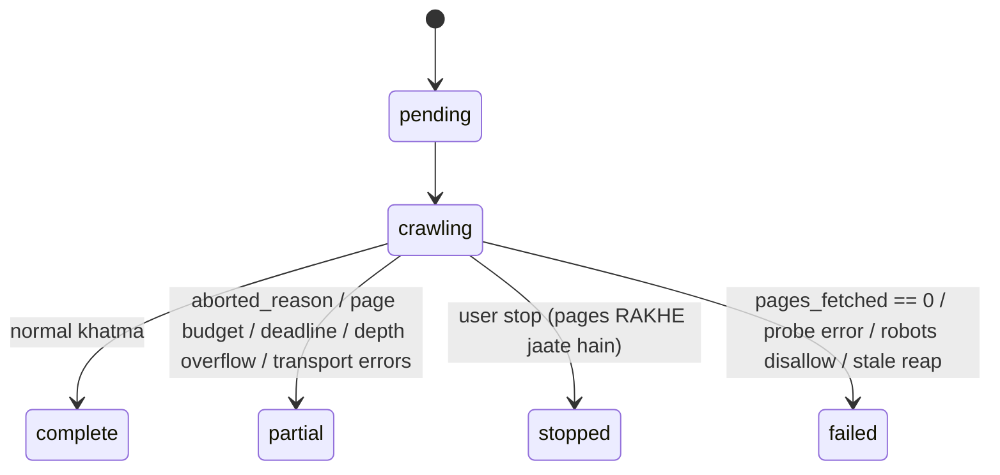

# Site crawl pipeline — `/api/site-crawls`

Code flow: [../Flows/02-site-crawl-flow.md](../Flows/02-site-crawl-flow.md) ·
Engine deep-dive: [../crawler.md](../crawler.md)

---

## 1. `POST /api/site-crawls` → **202**

```json
{
  "start_url": "example.com",
  "max_pages": 100,
  "max_depth": 3,
  "page_types": ["product"],
  "include_subdomains": false,
  "follow_nofollow": false,
  "seed_from_sitemap": true,
  "max_navigation_pages": null
}
```

| Field | Bounds | Default | Matlab |
|---|---|---|---|
| `start_url` | 1–2048 | required | Site ka koi bhi URL. Host isse derive. Scheme na ho to https assume |
| `max_pages` | 0 – `MAX_REQUESTABLE_PAGES = 5000` | setting `SITE_CRAWL_MAX_PAGES = 500` | **0 = koi page cap nahi** |
| `max_depth` | 0 – `MAX_REQUESTABLE_DEPTH = 10` | setting `SITE_CRAWL_MAX_DEPTH = 5` | Start URL se link-depth |
| `page_types` | `[]` / `["product"]` / `["collection"]` / dono | `[]` (sab) | Sirf yahi **targets** hain |
| `include_subdomains` | bool | setting (false) | `shop.example.com` bhi crawl karna hai? |
| `follow_nofollow` | bool | false | `rel=nofollow` links follow karne hain? |
| `seed_from_sitemap` | bool | true | Sitemap se frontier seed karna hai? |
| `max_navigation_pages` | 0–5000 | null | Non-target pages ka budget |

> Schema **clamp nahi** karta — `max_pages=1000000` par saaf **422** milega. Ek clear
> 422 ek silent clamp se behtar hai.

Response:

```json
{ "crawl_id": "...", "start_url": "https://example.com", "host": "example.com",
  "status": "pending", "reused": false }
```

Pre-flight: 2 requests (robots.txt + start page). `RobotsDisallowed` → **403**,
`FetchError` → **422** "Could not reach the site".

---

## 2. `GET /api/site-crawls/{crawl_id}` → **200**

Progress counters (~30 fields). Important waale:

| Group | Fields |
|---|---|
| Identity | `crawl_id`, `start_url`, `host`, `site_name`, `status`, `max_pages`, `max_depth`, `page_types` |
| Discovery | `pages_discovered`, `pages_fetched`, `pages_ok`, `seeded_from_sitemap`, `max_depth_seen` |
| Errors | `client_errors`, `server_errors`, `transport_errors` |
| Skips | `skipped_by_robots`, `skipped_asset`, `skipped_non_html`, `skipped_off_site`, `skipped_page_type`, `beyond_depth`, `not_attempted` |
| Throttle | `throttled`, `gave_up_throttled` |
| Targets | `target_pages`, `navigation_pages` |
| Templates | `templates_found`, `templates_measured` |
| Scoring | `pages_analyzed`, `avg_score`, `grade`, `critical_findings`, `warning_findings` |
| Headline issues | `orphan_count`, `noindex_count`, `missing_title_count`, `missing_description_count`, `broken_page_count` |
| Why it stopped | `progress_pct`, `hit_page_budget`, `deadline_hit`, `aborted_reason` |
| Persistence | `pages_persisted`, `persistence_ok` |
| Meta | `notes[]`, `elapsed_s`, `error`, `created_at`, `started_at`, `completed_at` |

### `progress_pct` ko sahi padho

Ye **page budget** ka fraction hai, "kitni site baaki hai" ka nahi. Ek crawl apna kaam
khud discover karta hai, isliye "found so far" ka percentage pehle page se hi 100%
dikhata.

`max_pages = 0` par koi denominator nahi hai — frontend indeterminate bar dikhata hai.

### `avg_score = null`

Matlab **page scoring off hai** (`SITE_CRAWL_ANALYZERS` khaali) — **ye nahi** ki sab
zero score hue.

### `persistence_ok = false`

Matlab MongoDB down tha: crawl chala, pages **save nahi hue**. `error` field batata hai.

---

## 3. States



| Status | Terminal? | Data use karne layak? |
|---|---|---|
| `pending` | nahi | — |
| `crawling` | nahi | counts under-report karte hain |
| `complete` | haan | haan |
| `partial` | haan | **haan** — jo mila wo valid hai |
| `stopped` | haan | **haan** — jo mila wo valid hai |
| `failed` | haan | nahi |

---

## 4. `POST /{crawl_id}/stop`

Cooperative. Current status return karta hai — jo abhi bhi `crawling` ho sakta hai.
Crawl current page finish karke, persist karke `stopped` par jaata hai.

**Client ko polling band nahi karni chahiye** — `stopped` agle poll par dikhega.

---

## 5. `GET /{crawl_id}/pages`

| Param | Bounds | Default |
|---|---|---|
| `limit` | 1–200 | 50 |
| `offset` | >=0 | 0 |
| `sort` | `depth` \| `url` \| `status` \| `words` \| `links` \| `score` | `depth` |
| `issue` | neeche ki list | none |
| `include_navigation` | bool | false |

### `issue` filter values

| Value | Matlab |
|---|---|
| `critical` / `warning` | Analyzers ne jo findings critical/warning rate kiye |
| `broken` | 4xx ya 5xx |
| `redirected` | Redirect se reach hua |
| `failed` | Fetch hi nahi ho paaya |
| `blocked_by_robots` | robots.txt ne crawl mana kiya |
| `noindex` | robots directive se search se bahar |
| `orphan` | Koi doosra crawled page yahan link nahi karta |
| `missing_title` / `missing_description` / `missing_canonical` | Tag missing |
| `no_h1` / `multiple_h1` / `heading_skips` | Heading problems |
| `thin` | <200 words |
| `images_missing_alt` | Alt text missing |
| `product` / `collection` | Page type filter |

Response:

```json
{ "crawl_id": "...", "host": "...", "pages": [ /* CrawledPage */ ],
  "total": 342, "limit": 50, "offset": 0, "issue": null, "include_navigation": false }
```

`total` = **filter match count**, poora crawl nahi.

> **List projections heavy fields drop karte hain**: `outlinks`, `headings`,
> `text_content`, `findings`, `h1`, `robots_meta`. Wo sirf `/page?url=` par milte hain.

---

## 6. `GET /{crawl_id}/page?url=`

Ek page **full detail** mein. `CrawledPage` ke saare fields + :

| Field | Matlab |
|---|---|
| `h1[]` | H1 texts (<=5) |
| `robots_meta` | Raw robots directive |
| `analyzer_scores` | `{analyzer: score \| null}` |
| `findings[]` | Poore findings (<=25) |
| `outlinks[]` | Is page se jaane wale links |
| **`inlinks[]`** | **Is page par aane wale links** |
| `headings[]` | Poora H1–H6 outline, document order mein (<=100) |
| `text_content` | Main body text, chrome stripped, `SITE_CRAWL_TEXT_CHARS` par capped |

**`inlinks` hi wo cheez hai jo single-page audit kabhi nahi de sakta.** "Is page par sirf
ek internal link hai, wo bhi sitemap se" — yahi explanation hoti hai ek page ke kabhi
rank na karne ki.

`url` is crawl mein nahi mila → **404**.

---

## 7. `GET /{crawl_id}/issues`

```json
{ "crawl_id": "...", "host": "...", "status": "complete",
  "counts": { "broken": 3, "orphan": 12, "missing_title": 0, ... },
  "orphans": [ "https://...", ... ],
  "orphan_count": 12,
  "orphans_truncated": false }
```

`orphans` list `MAX_ORPHANS_LISTED = 200` par capped hai; `orphan_count` phir bhi
**exact** hai, aur `orphans_truncated` batata hai ki list kati hai.

Report hamesha isi endpoint se shuru hoti hai.

---

## 8. `GET /{crawl_id}/templates`

```json
{ "crawl_id": "...", "host": "...", "found": 6, "measured": 6,
  "templates": [
    { "template": "product", "page_count": 284,
      "representative_url": "https://.../products/widget",
      "median_words": 412, "sample_urls": [ ... ],
      "lighthouse": { "performance_score": 64, "accessibility_score": 91,
                      "best_practices_score": 78, "seo_score": 100,
                      "lcp_ms": 3120, "inp_ms": 180, "cls": 0.04,
                      "tbt_ms": 410, "fcp_ms": 1840, "speed_index_ms": 3400,
                      "lighthouse_version": "...", "strategy": "mobile",
                      "fetched_url": "..." },
      "error": "", "measured_at": "..." }
  ] }
```

**Ek Lighthouse run per TEMPLATE, per page nahi.** Representative = us group ka **median
page by word count** — taaki ek asaamanya lamba ya khaali page poore template ko
describe na kar de.

Jo templates measure nahi hue (cap ke baad) wo bhi **listed** hote hain, `lighthouse:
null` aur ek `error` reason ke saath. Unhe drop karna "is store mein blog hai hi nahi"
jaisa padha jaata, jabki sach "humne blog measure nahi kiya" hai.

| Constant | Value |
|---|---|
| `MAX_TEMPLATES_TESTED` | 8 |
| `TEMPLATE_SAMPLE_CAP` | 600 pages |
| `TEMPLATE_CONCURRENCY` | 2 |
| `TEMPLATE_PHASE_TIMEOUT_S` | 480 s |
| `SITE_CRAWL_LIGHTHOUSE_STRATEGY` | `mobile` |

Template phase **crawl ko kabhi fail nahi karta** — timeout par bas kam templates
measured hote hain.

---

## 9. `GET /api/site-crawls?host=&limit=`

Newest first. `SiteCrawlSummary` ek chhota shape hai — `target_pages` use karo
(`pages_fetched` nahi) jab `page_types` filter set tha.

---

## 10. Limits aur budgets

| Constant / setting | Value |
|---|---|
| `MAX_CONCURRENT_SITE_CRAWLS` | 1 |
| `SITE_CRAWL_CONCURRENCY` (setting) | 6 |
| `SITE_CRAWL_DEADLINE_S` (setting) | 30 min |
| `SITE_CRAWL_MIN_INTERVAL_S` (setting) | 0.1 s (robots Crawl-delay ise **badha** sakta hai) |
| `SITE_CRAWL_INCLUDE_SUBDOMAINS` (setting) | false |
| `SITE_CRAWL_ANALYZERS` (setting) | `on_page,technical` |
| `SITE_CRAWL_TEXT_CHARS` (setting) | 8000 |
| `SITE_CRAWL_STALE_AFTER_S` | 180 s |
| `SITE_PROBE_TIMEOUT_SECONDS` | 30 s |
| `TIMEOUT_SECONDS` / `MAX_REDIRECTS` | 15 s / 5 |
| Page body cap | 2 MiB |
| `MAX_THROTTLE_RETRIES` | 4 |
| `MAX_SKIP_RECORDS` | 200 |
| `MAX_ORPHANS_LISTED` | 200 |
| Outlinks per page | <=300 (baaki `outlinks_dropped` count hote hain) |

---

## 11. Errors

| Status | Kab |
|---|---|
| 202 | Crawl create ho gaya |
| 403 | Site ka robots.txt crawler ko disallow karta hai |
| 404 | Unknown `crawl_id`; `/page?url=` ka URL is crawl mein nahi |
| 409 | Crawl terminal hone se pehle export/report maanga |
| 422 | `start_url` mein host nahi; body validation; probe site tak nahi pahuncha |
| 503 | Kisi bhi page-data read par MongoDB unreachable ("MongoDB unavailable: …") |

---

## 12. Polling

Frontend har **2000 ms** (`siteCrawlStore.ts::POLL_MS`). Terminal par poller ruk kar
`/issues`, `/templates` aur `/pages` ek saath load karta hai.
