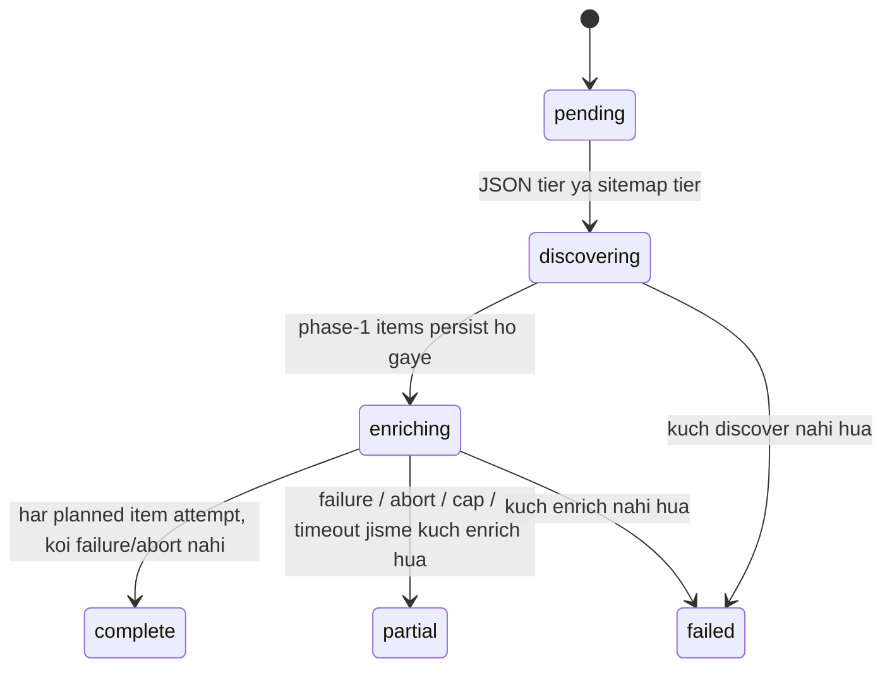
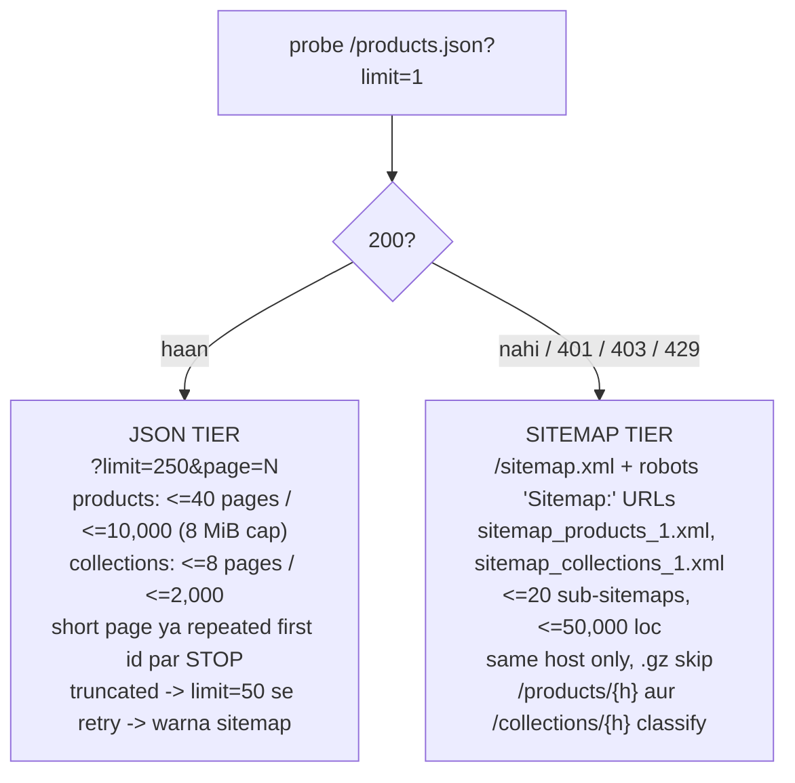

# Store catalog pipeline — `/api/stores`

Ek store ka poora catalog (products + collections) discover karo, har item ko uske
page `<head>` se enrich karo, aur SEO gaps flag karo.

Code flow: [../Flows/04-store-catalog-flow.md](../Flows/04-store-catalog-flow.md)

> **Route order load-bearing hai:** literal paths (`/crawl`, `/crawls`, `/crawl/{id}`)
> `{store_domain}` se **pehle** declare hone chahiye.

---

## 1. `POST /api/stores/crawl` → **202**

```json
{ "store_url": "example-store.com" }
```

Normalisation: scheme add hota hai, sirf http/https, host mein `.` hona chahiye,
query/fragment drop hote hain.

Response:

```json
{ "crawl_id": "...", "store_domain": "example-store.com",
  "status": "pending", "source": "products_json", "reused": false }
```

| `source` | Matlab |
|---|---|
| `products_json` | Products (aur collections, agar hain) JSON endpoints se aaye |
| `sitemap` | Dono mein se koi JSON se nahi aaya |
| `mixed` | Ek JSON se, doosra sitemap se |

### Pre-flight (2–4 requests)

```
SSRF guard (is_public_host)
  → origin resolve (256 KiB, </head> tak)
  → robots.txt
  → probe /products.json?limit=1, /collections.json?limit=1, /sitemap.xml
```

| Failure | Status |
|---|---|
| `RobotsDisallowed` (blanket disallow) | **403** |
| `CatalogUnavailable` | **422** "No product or collection catalog found … tried /products.json, /collections.json, /sitemap.xml" |
| `FetchError` (unreachable, non-public host) | **422** |

---

## 2. `GET /api/stores/crawl/{crawl_id}` → **200**

```json
{
  "crawl_id": "...", "store_url": "...", "store_domain": "...",
  "status": "complete", "source": "products_json",
  "total_products": 1240, "total_collections": 38,
  "products_enriched": 1240, "collections_enriched": 38,
  "enrich_failures": 0, "enrich_skipped": 0,
  "progress_pct": 100,
  "items_persisted": 1278, "revisions_written": 42, "persistence_ok": true,
  "shop_suffix": " | Example Store",
  "flag_counts": { "meta_description_missing": 312, ... },
  "error_message": null,
  "discovered_at": "...", "completed_at": "..."
}
```

### `progress_pct`

```
0    jab pending
5    jab discovering
5 + 95 * (enriched + failures) / total,  99 par capped
100  jab terminal
```

---

## 3. States



| Status | Kab |
|---|---|
| `failed` | Kuch bhi discover/enrich nahi hua; `RobotsDisallowed`/`CatalogUnavailable`/`FetchError`; ya phase timeout jisme kuch bhi enrich nahi hua |
| `partial` | Koi failure, ek abort (5 consecutive 429/503), enrichment cap hit, ya timeout jisme kuch enrich hua |
| `complete` | Har planned item attempt hua, koi failure nahi, koi abort nahi |

`error_message` exactly batata hai:

```
"Enrichment stopped early: 5 consecutive 429s."
"N item(s) were not enriched (CRAWL_MAX_ENRICH_ITEMS=2000)."
"The crawl exceeded its 1200s budget and was stopped."
"...could not be saved: MongoDB is unavailable."
```

**Koi stop endpoint nahi hai.**

---

## 4. Discovery tiers



---

## 5. Enrichment

| Constant / setting | Value | Matlab |
|---|---|---|
| `CRAWL_MAX_ENRICH_ITEMS` (setting) | 2000 | Iske baad ke items `not_enriched` flag paate hain |
| `CRAWL_ENRICH_CONCURRENCY` (setting) | 8 (blocked ho to 4) | Parallel `<head>` fetches |
| `DISCOVERY_TIMEOUT_SECONDS` | 120 s | Phase 1 |
| `CRAWL_TIMEOUT_SECONDS` | 1200 s | Phase 2 |
| `FLUSH_EVERY_ITEMS` / `FLUSH_EVERY_SECONDS` | 25 / 2.0 s | Mongo + SQL flush |
| HostGate min interval | >=0.06 s (Crawl-delay 2 s par clamp) | Politeness |
| Head read cap | 256 KiB (khaali to 768 KiB retry) | |
| Retry | transport/5xx par 1 | |
| Throttle | 429/503 par back off ×4; lagataar 5 ke baad **abort** | |

Plan ka order: **pehle collections, phir products** `updated_at` desc ke hisaab se —
taaki cap hit hone par sabse recently-updated items enriched hon.

> **Discovery uncapped hai, enrichment capped.** Wajah: enrichment ek `<head>` fetch per
> item (~0.2 s) hai, to ek 10,000-product store aadha ghanta crawl slot hold kar leta.
> Cap use `partial` par khatam karta hai.

---

## 6. Catalog read endpoints

### `GET /{store_domain}/products` · `/{store_domain}/collections`

| Param | Bounds | Default |
|---|---|---|
| `limit` | 1–200 | 50 |
| `offset` | >=0 | 0 |
| `sort` | `gaps` \| `name` \| `handle` | `gaps` (worst pehle) |
| `only_gaps` | bool | false |
| `flag` | koi bhi flag name | none |

```json
{ "items": [ /* StoreCatalogItem */ ], "total": 1240,
  "last_crawl_id": "...", "last_crawl_status": "complete",
  "last_crawled_at": "..." }
```

`total` = **filter match count**.

> `only_gaps` **mid-crawl under-report** karta hai: phase-1 docs par flags nahi hote jab
> tak enrichment un tak na pahunche. Terminal status ka wait karo.

Kabhi crawl na hua store → **empty list**, 404 nahi.

### `GET /{store_domain}/flags?kind=`

```json
{ "counts": { "meta_title_missing": 12, "meta_description_short": 310, ... } }
```

`kind` ∈ `product` \| `collection` (optional).

### `GET /{store_domain}/items/{kind}/{handle}`

```json
{ "item": { /* full */ },
  "description": "... poora, excerpt nahi ...",
  "revisions": [ /* <=20, captured_at desc */ ] }
```

Unknown item → **404** "Item not found…".

---

## 7. SEO gap flags

| Group | Flags | Threshold |
|---|---|---|
| Meta title | `meta_title_missing` · `meta_title_short` · `meta_title_long` · `meta_title_is_default` | <30 / >60 chars |
| Meta description | `meta_description_missing` · `_short` · `_long` · `_is_default` | <70 / >160 chars |
| Content | `description_missing` · `image_missing` · `image_alt_missing` · `collection_empty` | |
| Cross-item | `duplicate_meta_title` · `duplicate_meta_description` · `canonical_mismatch` | |
| Not enriched (**exactly ek**) | `not_enriched` · `page_unreachable` · `skipped_by_robots` | cap-skipped / fetch error / robots |

**`is_default`:** title mein se inferred **shop suffix** hataane par jo bacha wo item
name ke barabar hai. Description ke liye: pehle 120 chars description ke barabar.

**Shop suffix** = wo trailing `" | X"` / `" – X"` segment jo **>=60% enriched titles**
mein shared ho. Crawl ke final pass mein infer hota hai aur `shop_suffix` field mein
aata hai.

---

## 8. Storage

| Store | Collection / table | Identity |
|---|---|---|
| SQL | `store_crawls` | `id` — job state, counters, `flag_counts` JSON, `shop_suffix` |
| Mongo | `store_catalog_items` | `(store_domain, kind, handle)` unique |
| Mongo | `store_catalog_revisions` | `(store_domain, kind, handle, content_hash)` unique |

`content_hash` = SEO-relevant fields ka SHA-256, **sirf enrichment ke baad set hota
hai**. Badalne par ek revision likhi jaati hai — yahi history hai jo re-crawl banata hai.

`store_domain` **har read par normalise** hota hai: lower-case host, leading `www.` drop.

---

## 9. Errors

| Status | Kab |
|---|---|
| 202 | Crawl create ho gaya |
| 403 | robots.txt blanket-disallow |
| 404 | Unknown crawl id ya item |
| 422 | Host nahi; `CatalogUnavailable`; `FetchError`; query validation |
| 503 | Catalog read ke waqt MongoDB down |

---

## 10. Concurrency aur restart

| Cheez | Value |
|---|---|
| Concurrency | `MAX_CONCURRENT_CRAWLS = 2` |
| Heartbeat | **Nahi** |
| Stop | **Nahi** |
| Restart par | `reconcile_orphaned_crawls()` har non-terminal row ko failed: "…before this crawl finished." |
