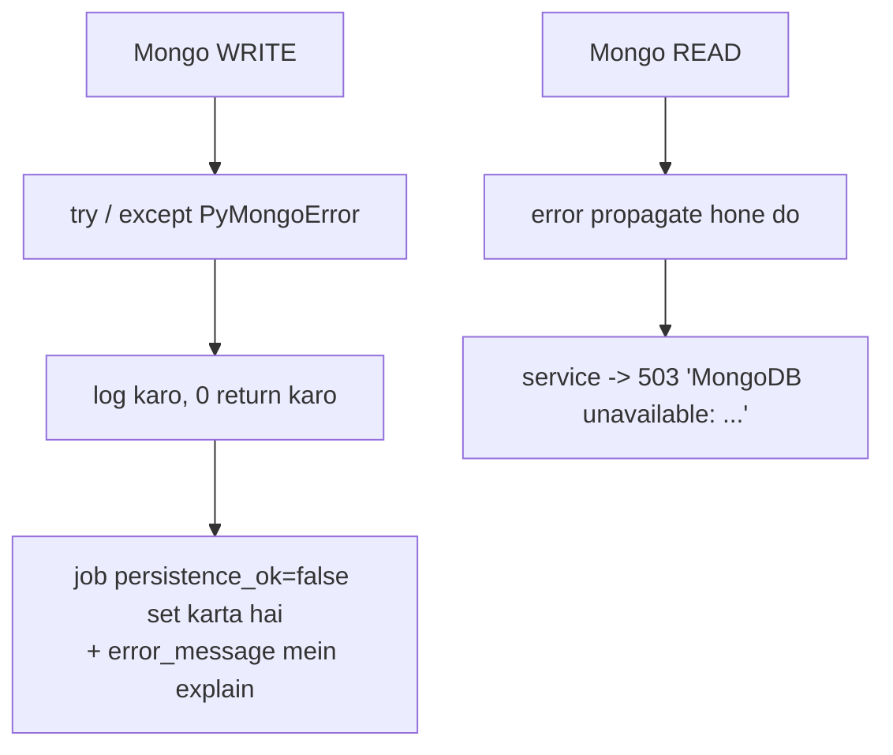

# Data model — SQL + MongoDB

**Do stores, jaan-boojh kar:**

| Store | Kya rakhta hai | Kyun |
|---|---|---|
| **SQL** (dev: SQLite `server/seo.db`) | Job rows, credentials, counters | Jo *pollable aur consistent* hona chahiye |
| **MongoDB** | Crawled pages, template reports, GSC rows, catalog items | Jo *bulk* data ek job produce karta hai |

---

## 1. SQL (`models/db.py`, SQLAlchemy async)

| Table (class) | Key columns | Kaam |
|---|---|---|
| `users` (`User`) | `id` (uuid PK), `created_at` | Anonymous session identity; pehle OAuth login par create |
| `audits` (`Audit`) | `id`, `url`, `user_id`, `status`, `overall_score`, `results_json`, `created_at`, `completed_at` | Single-page audit job + result |
| `google_credentials` | `user_id` (PK, FK users CASCADE), `refresh_token`, `access_token`, `token_expiry`, `scopes`, `updated_at` | GSC OAuth tokens — ek row per user, **kabhi serialise nahi hote** |
| `reddit_credentials` | `id`, `user_id` (unique FK), `reddit_username`, tokens, `token_expires_at`, `scopes`, karma, `account_created_at` | Reddit OAuth tokens |
| `reddit_posts` | `id` (= draft id), `user_id`, `store_url`, `subreddit`, `angle`, `kind`, `title`, `body_markdown`, flair, `status`, `fit_score`, `rule_check_notes`, `reddit_post_id`, `permalink`, `error_message`, `gemini_model`, `auto_published`, `published_at` | Drafts + publish results + **guardrail ledger** |
| `store_crawls` | `id`, `store_url`, `store_domain` (indexed), `status`, `source`, totals aur counters, `persistence_ok`, `shop_suffix`, `flag_counts` JSON, `error_message`, `discovered_at`, `completed_at` | Catalog crawl job state (items Mongo mein) |
| `site_crawls` | `id`, `start_url`, `host` (indexed), `site_name`, `status`, `max_pages`, `max_depth`, `page_types`, **~30 progress counters**, why-it-stopped flags, `pages_persisted`, `persistence_ok`, `options`, `notes`, `elapsed_s`, `started_at`, `heartbeat_at`, `completed_at` | Site crawl job state (pages Mongo mein) |
| `site_analyses` | `id`, `start_url`, `host` (indexed), `status`, `phase`, `crawl_id` (indexed), `gsc_connected`, `gsc_site_url`, `gsc_error`, `pages_fetched`, `avg_score`, `indexed_count`, `not_indexed_count`, `schema_gap_count`, `templates_measured`, `options`, `result_json`, `notes`, `heartbeat_at`, `completed_at` | Full-analysis coordinator |

### `site_crawls` ke counters (detail)

| Group | Columns |
|---|---|
| Discovery | `pages_discovered`, `pages_fetched`, `pages_ok`, `seeded_from_sitemap`, `max_depth_seen` |
| Errors | `client_errors`, `server_errors`, `transport_errors` |
| Skips | `skipped_by_robots`, `skipped_asset`, `skipped_non_html`, `skipped_off_site`, `skipped_page_type`, `beyond_depth`, `not_attempted` |
| Throttle | `throttled`, `gave_up_throttled` |
| Targets | `target_pages`, `navigation_pages` |
| Templates | `templates_found`, `templates_measured` |
| Findings | `pages_analyzed`, `avg_score`, `critical_findings`, `warning_findings` |
| Headline | `orphan_count`, `noindex_count`, `missing_title_count`, `missing_description_count`, `broken_page_count` |
| Why stopped | `hit_page_budget`, `deadline_hit`, `aborted_reason` |

---

## 2. SQL ko shape karne wale teen rules

### Rule 1 — Koi Alembic nahi hai

`init_db()` do kaam karta hai:

```python
await conn.run_sync(Base.metadata.create_all)      # missing TABLES
await conn.run_sync(_add_missing_columns)          # missing COLUMNS (sirf SQLite)
```

`_add_missing_columns` ek column tabhi add karta hai jab wo **nullable ya
server-defaulted** ho. Warna sirf warning log hoti hai.

**Matlab:**

| Situation | Kya karna |
|---|---|
| **Existing** table mein naya column | **Nullable rakho.** Code mein `row.x or 0` se padho |
| **Nayi** table | NOT NULL + defaults theek hain |
| Production mein schema change | Manual migration — koi tooling nahi hai |

### Rule 2 — SQLite timezone-naive datetimes deta hai

`DateTime(timezone=True)` columns SQLite se **naive** wapas aate hain. Services `_as_utc`
se normalise karti hain `datetime.now(UTC)` se compare karne se pehle.

```python
# Galat — TypeError: can't compare offset-naive and offset-aware
if row.heartbeat_at < datetime.now(UTC) - timedelta(seconds=180):

# Sahi
if _as_utc(row.heartbeat_at) < datetime.now(UTC) - timedelta(seconds=180):
```

### Rule 3 — Foreign keys `users` se cascade hoti hain

`google_credentials` aur `reddit_credentials` ka `user_id` FK with CASCADE hai.

Par `audits.user_id`, `store_crawls.user_id`, aur crawl/analysis ka `user_id` **plain
nullable strings** hain — kyunki ye jobs bina kisi connection ke bhi chal sakte hain.

---

## 3. MongoDB (`db/mongo.py`, `db/site_pages.py`, `db/store_catalog.py`)

**Ek `AsyncMongoClient` per process.** `serverSelectionTimeoutMS = connectTimeoutMS =
MONGODB_TIMEOUT_MS` (default 1500). Event loop badalne par client rebuild hota hai.
Database: `MONGODB_DB` (default `seo_remaster`).

**Indexes lazily create hote hain** — har client ke liye ek baar, first use par.

| Collection | Identity / indexes | Document |
|---|---|---|
| `site_crawl_pages` | unique `(crawl_id, url)`; depth, status, score, template, `(host, crawled_at desc)` | `CrawledPage` dump + `crawl_id`, `host`, `orphan`, `crawled_at` |
| `site_crawl_templates` | unique `(crawl_id, template)` | `template`, `page_count`, `representative_url`, `median_words`, `sample_urls[<=20]`, `lighthouse` (ya null), `error`, `measured_at` |
| `store_catalog_items` | unique `(store_domain, kind, handle)`; gaps desc, name, recency | Catalog fields + `description_excerpt` (200 chars), `seo_flags[]`, `seo_gap_count`, `content_hash`, `first_seen_at`, `last_seen_at`, `enriched_at`, `last_crawl_id`, `source` |
| `store_catalog_revisions` | unique `(store_domain, kind, handle, content_hash)`; `captured_at desc` | Har content change par SEO-relevant fields ka snapshot + `crawl_id`, `captured_at` (<=20 return) |
| `gsc_sites` | unique `(user_id, site_url)` | `permission_level`, `first_seen_at`, `last_seen_at` |
| `gsc_search_analytics` | unique `(user_id, site_url, start_date, end_date, dimensions, keys_key)`; clicks desc | `keys[]`, `clicks`, `impressions`, `ctr`, `position`, `fetched_at`, `first_fetched_at` |
| `gsc_syncs` | `(user_id, requested_at desc)` | Har fetch ka ek doc: range, dimensions, `row_count`, `rows_written` |

`keys_key` = `keys` array ko `\x1f` se join kiya hua.

### `site_crawl_pages` ka poora document

```
url, depth, discovered_from, final_url, status_code, content_type,
redirect_chain, elapsed_ms, truncated,
title, meta_description, canonical_url, lang, robots_meta, noindex, nofollow,
h1[<=5], h1_count, h2_count, word_count,
images, images_missing_alt,
headings[<=100], heading_count, heading_skips,
text_content,
internal_links, internal_nofollow_links, external_links, outlinks_dropped,
outlinks[],
score, grade, analyzer_scores, critical_count, warning_count, findings[<=25],
page_type, template, is_target, skipped, error,
crawl_id, host, orphan, crawled_at
```

---

## 4. Mongo ka write/read contract — ye yaad rakho



| | Writes | Reads |
|---|---|---|
| Error par | **Log + 0 return.** Kabhi raise nahi | **Propagate.** Service 503 deti hai |
| Kyun | Ek dead Mongo poore crawl ko fail nahi karna chahiye — bas feature degrade ho | User ko khaali list dikhana ("sab theek hai") ek 503 se zyada khatarnak hai |

**Upsert counts** `upserted + matched` hote hain — taaki ek unchanged re-crawl galti se
failure na samjha jaaye.

---

## 5. Page reads ka behaviour (`db/site_pages.py`)

| Cheez | Behaviour |
|---|---|
| **List projections** | Heavy fields drop hote hain: `outlinks`, `headings`, `text_content`, `findings`, `h1`, `robots_meta` |
| **Default filter** | `is_target != false` (navigation pages chupe rehte hain) |
| **`ISSUE_FILTERS`** | `issue` query param ko Mongo filters par map karta hai |
| **`iter_pages`** | url ke hisaab se sorted, **200 ke batches** mein stream |
| **Orphan marking** | **500 ke `$in` chunks** mein |

### `ISSUE_FILTERS` ki poori list

| Filter | Mongo condition (approx.) |
|---|---|
| `broken` | `status_code >= 400` |
| `redirected` | redirect chain non-empty |
| `noindex` | `noindex == true` |
| `missing_title` / `missing_description` / `missing_canonical` | field khaali |
| `multiple_h1` | `h1_count > 1` |
| `no_h1` | `h1_count == 0` |
| `thin` | `word_count < 200` |
| `images_missing_alt` | `images_missing_alt > 0` |
| `blocked_by_robots` | `skipped == "robots"` |
| `failed` | `error` non-empty |
| `orphan` | `orphan == true` |
| `critical` / `warning` | `critical_count > 0` / `warning_count > 0` |
| `product` / `collection` | `page_type` match |
| `heading_skips` | `heading_skips > 0` |

---

## 6. Cache (`utils/cache.py`)

| Backend | Kab |
|---|---|
| `RedisCache` | `REDIS_URL` set hai. Values JSON, `ex=ttl`. **Runtime errors misses maane jaate hain** |
| `InMemoryTTLCache` | Warna. `MAX_ENTRIES = 2000` — full hone par expired entries drop hoti hain, warna sabse purana quarter |

Default TTL: `CACHE_TTL_SECONDS = 3600`.

| Cache key | Kaun likhta hai |
|---|---|
| `psi:{strategy}:{categories}:{url}` | PageSpeed analyzer |
| GSC sites/rows | Audit ka `search_console` analyzer |
| `reddit:rules:{name}` | Subreddit rules endpoint |
| `store_profile:{url}` | Backlink draft generation |

**Failures kabhi cache nahi hote.**

---

## 7. Common mistakes

| Mistake | Kya hoga |
|---|---|
| Existing table mein NOT NULL column add karna | `_add_missing_columns` warn karega aur column add nahi hoga → runtime par "no such column" |
| Naive datetime ko aware se compare karna | `TypeError`. `_as_utc` use karo |
| Mongo write par raise karna | Ek Mongo outage poore crawl ko gira dega |
| Mongo read ko silently empty return karna | User ko "zero issues" dikhega jabki Mongo down tha |
| `only_gaps` ko mid-crawl trust karna | Under-report karega — phase-1 docs par flags nahi hote |
| `pages_fetched` use karna jab `page_types` filter set tha | `target_pages` use karo |
